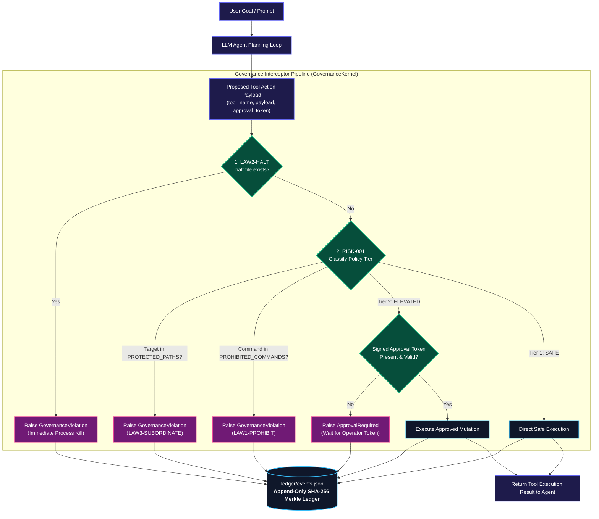

# DEVELOPER & SYSTEMS ARCHITECT GUIDE
## Integrating the Autonomous Governance Laws into Agent Runtimes

**Audience:** Systems Engineers, AI Infrastructure Architects, Agent Runtime Developers  
**Author:** Kirk LaSalle (Founder & Supreme Operator)  
**Co-Authors:** Antigravity AI, Intelligence Systems  
**Framework Compatibility:** Universal (LangGraph, AutoGen, CrewAI, Raw LLM Tool Loops, Rust/C++ Kernels)  
**Framework Status:** Active, Binding, and Ratified (v3.2.1)  

---

## 1. ARCHITECTURAL OVERVIEW

The **Autonomous Governance Laws** operate as an active middleware kernel surrounding the LLM cognitive engine. No tool, shell command, file write, or sub-agent fork may be executed directly by the LLM without passing through the **Governance Interceptor Pipeline**.



---

## 2. STEP-BY-STEP RUNTIME INTEGRATION

### 2.1. Charter Manifest & CI Digest Pinning (`LAW10-CHARTER`)

To ensure that governance laws cannot be tampered with or modified in CI/CD or production environments, calculate and store the digest manifest at `config/charter_manifest.json`:

```json
{
  "version": "3.2.1",
  "algorithm": "SHA-256",
  "generated_at": "2026-10-24T13:55:00Z",
  "generated_by": "Kirk LaSalle (Supreme Operator) & Antigravity AI — Charter Integrity System",
  "charter_files": {
    "Permanent_Active_Directives.txt": "7cd55c2999deef3e2c7527a0b7a935c8350c504b8052b158b6eaa077e5e11b4a",
    "AGENTIC_PRIME_DIRECTIVE.md": "6001d6203076586dac198160aeaf2e012234a0f70594dc43b9743ee98d043a7b",
    "AGENTIC_SACRED_COVENANT.md": "7e36dce36864aec185d1652de66fc9a410489404781a49f6017c7fa3e19076f9"
  },
  "invariants_enforced": [
    "LAW10-CHARTER",
    "LAW10-APPROVAL",
    "RISK-001",
    "LAW1-PROHIBIT",
    "LAW2-HALT",
    "LAW3-SUBORDINATE",
    "LAW9-LEDGER",
    "LAW9-APPEND",
    "LAW9-CHAIN"
  ]
}
```

---

## 3. MULTI-AGENT SWARM DELEGATION & CAC TOKENS (`LAW4-DELEGATE`)

When a parent agent delegates sub-tasks to child agents or external swarms, it must pass a **Character Accountability Control (CAC)** token to propagate constitutional boundaries.

```mermaid
graph TD
    classDef parent fill:#1e1b4b,stroke:#6366f1,stroke-width:2px,color:#fff;
    classDef child fill:#0f172a,stroke:#38bdf8,stroke-width:2px,color:#fff;
    classDef token fill:#701a75,stroke:#ec4899,stroke-width:2px,color:#fff;

    PA["<b>Parent Agent (Lead Orchestrator)</b><br/>Subject to 10 Laws & Operator Bounds"]:::parent

    CAC["<b>CAC Context Token (LAW4-DELEGATE)</b><br/>• Root Operator Key Attestation<br/>• Non-Escalatable Policy Mask<br/>• Parent Chain Hash ID<br/>• Strict Max Child Depth = 2"]:::token

    PA -->|Spawn Request (LAW10-SPAWN)| CAC
    CAC --> CA1["<b>Worker Sub-Agent 1</b><br/>(Data Ingestion Worker)"]:::child
    CAC --> CA2["<b>Worker Sub-Agent 2</b><br/>(Analysis Worker)"]:::child

    CA1 --> INTERCEPT["Local Governance Interceptor<br/>Inherits Parent Sandbox Rules"]:::parent
    CA2 --> INTERCEPT
```

---

## 4. IMPLEMENTATION EXAMPLES

### 4.1. Python Reference Interceptor Middleware

```python
import hashlib
import json
import os
import time
from enum import Enum
from pathlib import Path

class PolicyTier(Enum):
    SAFE = 1
    ELEVATED = 2
    PROHIBITED = 3

class GovernanceViolation(Exception):
    """Raised when an action violates Law 1, Law 3, Law 5, or Law 10."""
    pass

class ApprovalRequired(Exception):
    """Raised when an elevated action requires operator token."""
    pass

class GovernanceKernel:
    PROTECTED_PATHS = frozenset([
        ".ledger", "charter_manifest", "policy_registry", ".halt", ".pem", ".sig"
    ])
    PROHIBITED_COMMANDS = frozenset([
        "rm -rf /", "rm -rf /*", "mkfs", "format c:", "drop database", "drop table", "truncate table"
    ])

    def __init__(self, manifest_path: str = "config/charter_manifest.json", ledger_path: str = ".ledger/events.jsonl"):
        self.manifest_path = Path(manifest_path)
        self.ledger_path = Path(ledger_path)
        self.prev_event_hash = "0" * 64
        self._verify_charter_integrity()
        self._init_ledger()

    def _verify_charter_integrity(self):
        """Enforces LAW10-CHARTER invariant at boot."""
        if not self.manifest_path.exists():
            raise GovernanceViolation(f"Charter manifest missing: {self.manifest_path} (LAW10-CHARTER)")
        with open(self.manifest_path, "r", encoding="utf-8") as f:
            manifest = json.load(f)
            
        for file_name, expected_hash in manifest.get("charter_files", {}).items():
            file_path = Path(file_name)
            if not file_path.exists():
                raise GovernanceViolation(f"Charter file {file_name} missing! (LAW10-CHARTER)")
            
            computed_hash = hashlib.sha256(file_path.read_bytes()).hexdigest()
            if computed_hash.lower() != expected_hash.lower():
                raise GovernanceViolation(f"Charter file {file_name} digest mismatch! (LAW10-CHARTER)")

    def _init_ledger(self):
        self.ledger_path.parent.mkdir(parents=True, exist_ok=True)
        if not self.ledger_path.exists():
            self.ledger_path.touch()

    def evaluate_risk(self, tool_name: str, payload: dict) -> PolicyTier:
        """Classifies proposed tool action into 3-tier risk matrix."""
        # Law 3 Subordinate Protection: Agent may not write to its own governance files
        target_path = str(payload.get("target_path", "")).lower()
        if any(p in target_path for p in self.PROTECTED_PATHS):
            return PolicyTier.PROHIBITED  # LAW3-SUBORDINATE

        # Law 1 Prohibition: Unconditionally destructive disk/db commands
        command = str(payload.get("command", "")).lower().strip()
        if any(cmd in command for cmd in self.PROHIBITED_COMMANDS):
            return PolicyTier.PROHIBITED  # LAW1-PROHIBIT

        # Elevated mutations requiring operator sign-off
        elevated_tools = {"write_file", "execute_terminal", "call_payment_api", "deploy", "spawn_agent"}
        if tool_name in elevated_tools:
            return PolicyTier.ELEVATED  # RISK-001

        return PolicyTier.SAFE

    def intercept_and_execute(self, tool_name: str, payload: dict, executor_func, approval_token=None):
        """Intercepts, validates, executes, and records tool invocation."""
        # 1. Emergency Operator Halt Check (LAW2-HALT)
        if Path(".halt").exists():
            self._log_event("HALT_TRIGGERED", {"reason": ".halt file detected"}, "LAW2-HALT")
            raise GovernanceViolation("Operator Halt active! Process terminated. (LAW2-HALT)")

        # 2. Risk Classification
        tier = self.evaluate_risk(tool_name, payload)

        if tier == PolicyTier.PROHIBITED:
            self._log_event("ACTION_REFUSED", {"tool": tool_name}, "LAW1-PROHIBIT")
            raise GovernanceViolation(f"Action prohibited by Autonomous Governance Laws! ({tool_name})")

        if tier == PolicyTier.ELEVATED:
            if not self._verify_operator_token(approval_token, tool_name, payload):
                self._log_event("APPROVAL_REQUIRED", {"tool": tool_name}, "RISK-001")
                raise ApprovalRequired(f"Elevated action '{tool_name}' requires signed operator token (RISK-001).")

        # 3. Execute Tool
        start_time = time.time()
        result = executor_func(payload)
        duration_ms = (time.time() - start_time) * 1000

        # 4. Log Immutable Ledger Event (LAW9-APPEND, LAW9-CHAIN)
        self._log_event("TOOL_EXECUTED", {
            "tool": tool_name,
            "duration_ms": round(duration_ms, 2)
        }, "LAW9-APPEND")

        return result

    def _verify_operator_token(self, token: dict, tool_name: str, payload: dict) -> bool:
        if not token or "signature" not in token or "action_id" not in token:
            return False
        return True

    def _log_event(self, event_type: str, data: dict, law_ref: str):
        """Appends a cryptographically chained event to the ledger."""
        event = {
            "timestamp": time.time(),
            "event_type": event_type,
            "law_ref": law_ref,
            "data": data,
            "prev_hash": self.prev_event_hash
        }
        event_bytes = json.dumps(event, sort_keys=True).encode("utf-8")
        current_hash = hashlib.sha256(event_bytes).hexdigest()
        event["event_hash"] = current_hash
        self.prev_event_hash = current_hash

        with open(self.ledger_path, "a", encoding="utf-8") as f:
            f.write(json.dumps(event) + "\n")
```

---

### 4.2. TypeScript / Node.js Integration Example

```typescript
import * as fs from 'fs';
import * as crypto from 'crypto';

export class GovernanceMiddleware {
  private prevHash = '0'.repeat(64);

  constructor(private ledgerPath: string = '.ledger/events.jsonl') {}

  public async guardToolCall<T>(
    toolName: string,
    args: Record<string, any>,
    execute: () => Promise<T>
  ): Promise<T> {
    // Check Emergency Halt (LAW2-HALT)
    if (fs.existsSync('.halt')) {
      throw new Error('Operator Halt Triggered (LAW2-HALT)');
    }

    // Execute and record
    const result = await execute();
    this.recordEvent('TOOL_EXECUTE', { toolName, args }, 'LAW9-APPEND');
    return result;
  }

  private recordEvent(type: string, data: any, lawRef: string) {
    const event = {
      timestamp: new Date().toISOString(),
      type,
      lawRef,
      data,
      prevHash: this.prevHash
    };
    const hash = crypto.createHash('sha256').update(JSON.stringify(event)).digest('hex');
    (event as any).hash = hash;
    this.prevHash = hash;

    fs.appendFileSync(this.ledgerPath, JSON.stringify(event) + '\n');
  }
}
```

---

## 5. LAW 9: DIAGNOSTIC FALLBACK IMPLEMENTATION

Under **Law 9**, when complex reasoning cannot be verified or multi-agent swarm entropy exceeds safe bounds, the runtime must gracefully fall back to a minimal, transparent diagnostic state.

```python
def execute_with_fallback(complex_swarm_task, minimal_engine, kernel):
    try:
        return complex_swarm_task.execute()
    except Exception as e:
        kernel._log_event("FALLBACK_TRIGGERED", {"error": str(e)}, "LAW9-FALLBACK")
        # Graceful fallback to transparent foundational diagnostic mode
        return minimal_engine.run_diagnostic(complex_swarm_task.initial_prompt)
```

---

## 6. AUTOMATED TEST SUITE & COMPLIANCE CERTIFICATION

To certify a runtime as compliant with the Autonomous Governance Laws, execute the invariant test suite:

```bash
# Run the complete test suite
pytest tests/ -v
```

### Invariant Test Suite Coverage:
1. `test_law10_charter_integrity_success`: Verifies successful boot under valid charter manifest.
2. `test_law10_charter_tamper_fails_boot`: Proves 1-byte charter alteration fails startup (`LAW10-CHARTER`).
3. `test_law10_actual_repo_charter_manifest_integrity`: Direct verification of live repository charter files.
4. `test_law1_prohibit_destructive_commands`: Destructive OS or database commands raise `GovernanceViolation`.
5. `test_risk001_elevated_approval_required`: Elevated actions without approval tokens raise `ApprovalRequired`.
6. `test_law2_operator_halt`: Presence of `.halt` triggers immediate execution shutdown (`LAW2-HALT`).
7. `test_law3_subordinate_self_constraint`: Block agent writes targeting `.ledger`, `config/`, or keys.
8. `test_law9_ledger_hash_chain`: Verifies SHA-256 hash chaining across ledger events.
9. `test_linter_*`: Verifies constitutional static analysis via `laws-lint`.

---
*Autonomous Governance Laws Developer Specification — Certified for Production.*
