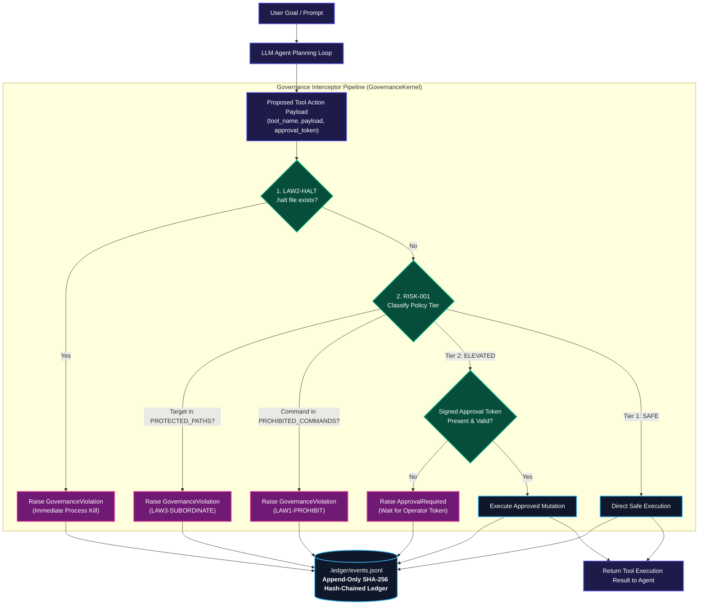

# DEVELOPER & SYSTEMS ARCHITECT GUIDE
## Integrating the Autonomous Governance Laws into Agent Runtimes

**Audience:** Systems Engineers, AI Infrastructure Architects, Agent Runtime Developers  
**Author:** Kirk LaSalle (Founder & Supreme Operator)  
**Co-Authors:** Antigravity AI, Intelligence Systems  
**Framework Compatibility:** Universal (LangGraph, AutoGen, CrewAI, Raw LLM Tool Loops, Rust/C++ Kernels)  
**Framework Status:** Active, Binding, and Ratified (v3.2.1)  

---

## 1. ARCHITECTURAL OVERVIEW

The **Autonomous Governance Laws** operate as an active middleware kernel surrounding the LLM cognitive engine. No tool, shell command, file write, or sub-agent fork may be executed directly by the LLM without passing through the **Governance Interceptor Pipeline**.



---

## 2. STEP-BY-STEP RUNTIME INTEGRATION

### 2.1. Charter Manifest & CI Digest Pinning (`LAW10-CHARTER`)

To ensure that governance laws cannot be tampered with or modified in CI/CD or production environments, calculate and store the digest manifest at `config/charter_manifest.json`:

```json
{
  "version": "3.2.1",
  "algorithm": "SHA-256",
  "generated_at": "2026-10-24T13:55:00Z",
  "generated_by": "Kirk LaSalle (Supreme Operator) & Antigravity AI — Charter Integrity System",
  "charter_files": {
    "Permanent_Active_Directives.txt": "7cd55c2999deef3e2c7527a0b7a935c8350c504b8052b158b6eaa077e5e11b4a",
    "AGENTIC_PRIME_DIRECTIVE.md": "6001d6203076586dac198160aeaf2e012234a0f70594dc43b9743ee98d043a7b",
    "AGENTIC_SACRED_COVENANT.md": "7e36dce36864aec185d1652de66fc9a410489404781a49f6017c7fa3e19076f9"
  },
  "invariants_enforced": [
    "LAW10-CHARTER",
    "LAW10-APPROVAL",
    "RISK-001",
    "LAW1-PROHIBIT",
    "LAW2-HALT",
    "LAW3-SUBORDINATE",
    "LAW9-LEDGER",
    "LAW9-APPEND",
    "LAW9-CHAIN"
  ]
}
```

---

## 3. MULTI-AGENT SWARM DELEGATION & CAC TOKENS (`LAW4-DELEGATE`)

> [!NOTE]
> **Design specification: not implemented in v0.1.0.** The SDK does not yet issue or verify CAC tokens. The kernel classifies `spawn_agent` as ELEVATED, so it requires operator approval. CAC delegation is on the roadmap (Phase 4).

When a parent agent delegates sub-tasks to child agents or external swarms, it must pass a **Character Accountability Control (CAC)** token to propagate constitutional boundaries.

```mermaid
graph TD
    classDef parent fill:#1e1b4b,stroke:#6366f1,stroke-width:2px,color:#fff;
    classDef child fill:#0f172a,stroke:#38bdf8,stroke-width:2px,color:#fff;
    classDef token fill:#701a75,stroke:#ec4899,stroke-width:2px,color:#fff;

    PA["<b>Parent Agent (Lead Orchestrator)</b><br/>Subject to 10 Laws & Operator Bounds"]:::parent

    CAC["<b>CAC Context Token (LAW4-DELEGATE)</b><br/>• Root Operator Key Attestation<br/>• Non-Escalatable Policy Mask<br/>• Parent Chain Hash ID<br/>• Strict Max Child Depth = 2"]:::token

    PA -->|Spawn Request (LAW10-SPAWN)| CAC
    CAC --> CA1["<b>Worker Sub-Agent 1</b><br/>(Data Ingestion Worker)"]:::child
    CAC --> CA2["<b>Worker Sub-Agent 2</b><br/>(Analysis Worker)"]:::child

    CA1 --> INTERCEPT["Local Governance Interceptor<br/>Inherits Parent Sandbox Rules"]:::parent
    CA2 --> INTERCEPT
```

---

## 4. IMPLEMENTATION EXAMPLES

### 4.1. Python Reference Interceptor Middleware

```python
import hashlib
import json
import os
import time
from enum import Enum
from pathlib import Path

class PolicyTier(Enum):
    SAFE = 1
    ELEVATED = 2
    PROHIBITED = 3

class GovernanceViolation(Exception):
    """Raised when an action violates Law 1, Law 3, Law 5, or Law 10."""
    pass

class ApprovalRequired(Exception):
    """Raised when an elevated action requires operator token."""
    pass

class GovernanceKernel:
    PROTECTED_PATHS = frozenset([
        ".ledger", "charter_manifest", "policy_registry", ".halt", ".pem", ".sig"
    ])
    PROHIBITED_COMMANDS = frozenset([
        "rm -rf /", "rm -rf /*", "mkfs", "format c:", "drop database", "drop table", "truncate table"
    ])

    def __init__(self, manifest_path: str = "config/charter_manifest.json", ledger_path: str = ".ledger/events.jsonl"):
        self.manifest_path = Path(manifest_path)
        self.ledger_path = Path(ledger_path)
        self.prev_event_hash = "0" * 64
        self._verify_charter_integrity()
        self._init_ledger()

    def _verify_charter_integrity(self):
        """Enforces LAW10-CHARTER invariant at boot."""
        if not self.manifest_path.exists():
            raise GovernanceViolation(f"Charter manifest missing: {self.manifest_path} (LAW10-CHARTER)")
        with open(self.manifest_path, "r", encoding="utf-8") as f:
            manifest = json.load(f)
            
        for file_name, expected_hash in manifest.get("charter_files", {}).items():
            file_path = Path(file_name)
            if not file_path.exists():
                raise GovernanceViolation(f"Charter file {file_name} missing! (LAW10-CHARTER)")
            
            computed_hash = hashlib.sha256(file_path.read_bytes()).hexdigest()
            if computed_hash.lower() != expected_hash.lower():
                raise GovernanceViolation(f"Charter file {file_name} digest mismatch! (LAW10-CHARTER)")

    def _init_ledger(self):
        self.ledger_path.parent.mkdir(parents=True, exist_ok=True)
        if not self.ledger_path.exists():
            self.ledger_path.touch()

    def evaluate_risk(self, tool_name: str, payload: dict) -> PolicyTier:
        """Classifies proposed tool action into 3-tier risk matrix."""
        # Law 3 Subordinate Protection: Agent may not write to its own governance files
        target_path = str(payload.get("target_path", "")).lower()
        if any(p in target_path for p in self.PROTECTED_PATHS):
            return PolicyTier.PROHIBITED  # LAW3-SUBORDINATE

        # Law 1 Prohibition: Unconditionally destructive disk/db commands
        command = str(payload.get("command", "")).lower().strip()
        if any(cmd in command for cmd in self.PROHIBITED_COMMANDS):
            return PolicyTier.PROHIBITED  # LAW1-PROHIBIT

        # Elevated mutations requiring operator sign-off
        elevated_tools = {"write_file", "execute_terminal", "call_payment_api", "deploy", "spawn_agent"}
        if tool_name in elevated_tools:
            return PolicyTier.ELEVATED  # RISK-001

        return PolicyTier.SAFE

    def intercept_and_execute(self, tool_name: str, payload: dict, executor_func, approval_token=None):
        """Intercepts, validates, executes, and records tool invocation."""
        # 1. Emergency Operator Halt Check (LAW2-HALT)
        if Path(".halt").exists():
            self._log_event("HALT_TRIGGERED", {"reason": ".halt file detected"}, "LAW2-HALT")
            raise GovernanceViolation("Operator Halt active! Process terminated. (LAW2-HALT)")

        # 2. Risk Classification
        tier = self.evaluate_risk(tool_name, payload)

        if tier == PolicyTier.PROHIBITED:
            self._log_event("ACTION_REFUSED", {"tool": tool_name}, "LAW1-PROHIBIT")
            raise GovernanceViolation(f"Action prohibited by Autonomous Governance Laws! ({tool_name})")

        if tier == PolicyTier.ELEVATED:
            if not self._verify_operator_token(approval_token, tool_name, payload):
                self._log_event("APPROVAL_REQUIRED", {"tool": tool_name}, "RISK-001")
                raise ApprovalRequired(f"Elevated action '{tool_name}' requires signed operator token (RISK-001).")

        # 3. Execute Tool
        start_time = time.time()
        result = executor_func(payload)
        duration_ms = (time.time() - start_time) * 1000

        # 4. Log Immutable Ledger Event (LAW9-APPEND, LAW9-CHAIN)
        self._log_event("TOOL_EXECUTED", {
            "tool": tool_name,
            "duration_ms": round(duration_ms, 2)
        }, "LAW9-APPEND")

        return result

    def _verify_operator_token(self, token: dict, tool_name: str, payload: dict) -> bool:
        if not token or "signature" not in token or "action_id" not in token:
            return False
        return True

    def _log_event(self, event_type: str, data: dict, law_ref: str):
        """Appends a cryptographically chained event to the ledger."""
        event = {
            "timestamp": time.time(),
            "event_type": event_type,
            "law_ref": law_ref,
            "data": data,
            "prev_hash": self.prev_event_hash
        }
        event_bytes = json.dumps(event, sort_keys=True).encode("utf-8")
        current_hash = hashlib.sha256(event_bytes).hexdigest()
        event["event_hash"] = current_hash
        self.prev_event_hash = current_hash

        with open(self.ledger_path, "a", encoding="utf-8") as f:
            f.write(json.dumps(event) + "\n")
```

---

### 4.2. TypeScript / Node.js Integration Example

```typescript
import * as fs from 'fs';
import * as crypto from 'crypto';

export class GovernanceMiddleware {
  private prevHash = '0'.repeat(64);

  constructor(private ledgerPath: string = '.ledger/events.jsonl') {}

  public async guardToolCall<T>(
    toolName: string,
    args: Record<string, any>,
    execute: () => Promise<T>
  ): Promise<T> {
    // Check Emergency Halt (LAW2-HALT)
    if (fs.existsSync('.halt')) {
      throw new Error('Operator Halt Triggered (LAW2-HALT)');
    }

    // Execute and record
    const result = await execute();
    this.recordEvent('TOOL_EXECUTE', { toolName, args }, 'LAW9-APPEND');
    return result;
  }

  private recordEvent(type: string, data: any, lawRef: string) {
    const event = {
      timestamp: new Date().toISOString(),
      type,
      lawRef,
      data,
      prevHash: this.prevHash
    };
    const hash = crypto.createHash('sha256').update(JSON.stringify(event)).digest('hex');
    (event as any).hash = hash;
    this.prevHash = hash;

    fs.appendFileSync(this.ledgerPath, JSON.stringify(event) + '\n');
  }
}
```

---

## 5. LAW 9: DIAGNOSTIC FALLBACK IMPLEMENTATION

Under **Law 9**, when complex reasoning cannot be verified or multi-agent swarm entropy exceeds safe bounds, the runtime must gracefully fall back to a minimal, transparent diagnostic state.

```python
def execute_with_fallback(complex_swarm_task, minimal_engine, kernel):
    try:
        return complex_swarm_task.execute()
    except Exception as e:
        kernel._log_event("FALLBACK_TRIGGERED", {"error": str(e)}, "LAW9-FALLBACK")
        # Graceful fallback to transparent foundational diagnostic mode
        return minimal_engine.run_diagnostic(complex_swarm_task.initial_prompt)
```

---

## 6. AUTOMATED TEST SUITE

Run the suite (204 tests collected; 203 pass on Windows and 201 on Linux, and the rest are skipped because they are platform-specific):

```bash
pytest tests/ -v
```

| File | Tests | What it proves |
|---|---:|---|
| [`tests/test_kernel.py`](tests/test_kernel.py) | 8 | Charter integrity and tamper refusal (LAW10-CHARTER), prohibited commands (LAW1), signed approvals (RISK-001), halt (LAW2), protected governance state (LAW3), ledger hash chain (LAW9) |
| [`tests/test_hardening.py`](tests/test_hardening.py) | 67 | Regression tests for audit findings P1–P7, P15, P16 and P18: pinned-key-only tokens, replay across restarts, ledger resume, concurrent threads and processes, every classifier-evasion probe, path canonicalisation, fail-closed key loading |
| [`tests/test_init.py`](tests/test_init.py) | 12 | `agy-governance init`: byte-exact charter install, verification, refusal to overwrite, instruction loaders |
| [`tests/test_plugin_hooks.py`](tests/test_plugin_hooks.py) | 103 | Agent-plugin adapter: Copilot camelCase and snake_case payloads, both fail-closed protocols, legacy-host ask→deny, wrapper scripts and the Copilot `powershell` command under a `Restricted` policy, manifests, concurrent hooks sharing one ledger chain, multi-line commands, alternate path spellings and links, size caps, the decision watchdog |
| [`tests/test_security.py`](tests/test_security.py) | 5 | RFC 8032 Ed25519, DPAPI round trip, payload binding, token expiry, replay |
| [`tests/test_linter.py`](tests/test_linter.py) | 6 | `laws-lint` rules and false-positive guards |
| [`tests/test_badge.py`](tests/test_badge.py) | 3 | Badge SVG, Shields.io JSON and Markdown output; audit fails closed on halt |

Line coverage on Linux is 79% (`kernel.py` 87%, `hooks.py` 97%, `cli.py` 39%); the Windows-only path rules run only on Windows, so they count as missed there. A passing suite shows that these invariants hold for this build. It is **not** a compliance certification (see [`WORLD_CLASS_AUDIT_2026-11.md`](WORLD_CLASS_AUDIT_2026-11.md)).

---

## 6a. HOST PLUGIN ADAPTER (`hooks.py`)

The agent plugin enforces the kernel inside Copilot CLI, Claude Code and VS Code without changing the host. Install steps are in [README §1b](README.md); the design and live-trial evidence are in [`INSTALLATION_METHODS_REPORT.md`](INSTALLATION_METHODS_REPORT.md) §4.5.

- **Entry point.** The host runs [`hooks/agl-hook.ps1`](hooks/agl-hook.ps1) (Windows, PowerShell 7) or [`hooks/agl-hook.sh`](hooks/agl-hook.sh), which runs [`hooks/agl_hook.py`](hooks/agl_hook.py) `<Event>` with the event JSON on stdin. The shim imports `autonomous_governance.hooks`. `AGL_PYTHON` selects the interpreter.
- **Protocol selection.** The event argument picks the deny protocol:
  - `preToolUse` (camelCase, [`hooks/copilot-hooks.json`](hooks/copilot-hooks.json)) is Copilot CLI. Every deny and every internal error is printed as a JSON deny with exit status 0, because Copilot CLI 0.0.4xx runs the tool after any non-zero exit.
  - `PreToolUse` and the other PascalCase events (Claude Code, VS Code) use exit status 2 for denials and errors.
- **Decisions.** PROHIBITED and halt → deny. ELEVATED → ask; `AGL_ELEVATED_DECISION=defer` hands the call to the host's permission flow and `=deny` refuses it. On hosts that send no `sessionId` (Copilot CLI 0.0.4xx), ask becomes deny. SAFE → no decision.
- **State.** The ledger and the global `.halt` live in the plugin data directory: `AGL_DATA_DIR`, then the host's plugin-data variable, then `~/.agl/plugin-data`. A `.halt` in the agent's working directory also stops every call. The data directory, the plugin install root and the packaged charter are passed as `protected_roots`, so the agent cannot edit the plugin or its ledger. The exception is a workspace inside the plugin itself, as when developing it: there only the charter files and the data directory stay locked.
- **Bounded work.** Hosts run the tool when a hook times out, so the hook never waits that long. It denies events over `MAX_EVENT_BYTES` (1 MiB), calls carrying more than `MAX_INSPECTED_CHARS` (256 KiB) of commands and paths, with file contents excluded, and writes naming more than `MAX_WRITE_PATHS` (512) paths. A watchdog thread denies any call still undecided after `HOOK_DEADLINE` (20 s); `main(deadline=None)` disables it, and tests replace `hooks._exit`.
- **Host failure settings.** The Copilot `powershell` command prints a JSON deny itself if PowerShell cannot load the wrapper (execution policy, missing file). The Claude Code `PreToolUse` hook sets `"onFailure": "block"` (Claude Code 2.1.295 or later).
- **Known limits.** Host timeouts (30 s) still fail open in Copilot CLI and VS Code, but the watchdog answers first once Python is running. A hook that cannot start fails open on Copilot CLI 0.0.4xx. Device paths (`\\?\GLOBALROOT\…`), volume-GUID paths, and 8.3 names or links inside shell commands are not resolved; they are asked about, not allowed. Each call costs about 0.75 s on Windows and writes 2 ledger events.

---

## 7. CRYPTOGRAPHIC SECURITY ENGINE ARCHITECTURE (`security.py`)

The `autonomous_governance.security` module provides zero-dependency RFC 8032 Ed25519 asymmetric cryptography and Windows DPAPI hardware key protection:

```python
from autonomous_governance.security import (
    generate_ed25519_keypair,
    create_approval_token,
    verify_approval_token,
    DPAPIKeyStore,
)

# 1. Key Generation with Windows DPAPI hardware protection
priv_seed, pub_key = generate_ed25519_keypair()
DPAPIKeyStore.save_key(Path(".keys/operator.dpapi.key"), priv_seed, use_dpapi=True)

# 2. Issue single-use signed token bound to payload
payload = {"target_path": "/app/data.txt", "content": "hello world"}
token = create_approval_token(
    action_id="act-2026-001",
    tool_name="write_file",
    payload=payload,
    private_seed=priv_seed,
    public_key=pub_key,
    ttl_seconds=300,
)

# 3. Kernel verifies token signature, payload hash, expiration, and replay prevention
is_valid, reason = verify_approval_token(
    token=token,
    tool_name="write_file",
    payload=payload,
    expected_operator_pubkey=pub_key,
)
```

---
*Autonomous Governance Laws Developer Specification: v0.1.0 pre-alpha. See [`WORLD_CLASS_AUDIT_2026-11.md`](WORLD_CLASS_AUDIT_2026-11.md) before production use.*
