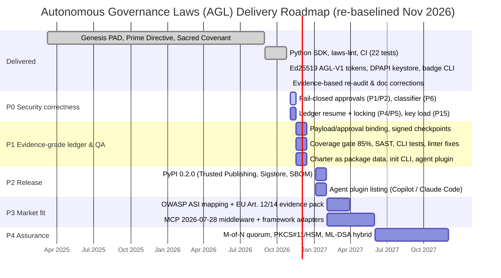

# EXECUTIVE SUMMARY & CONSOLIDATED SCORECARD

**Document Version:** 3.0.0 (Evidence-Based Re-Audit)  
**Date:** November 1, 2026  
**Prepared For:** Kirk LaSalle, Founder & Supreme Operator  
**Classification:** Board-Ready Executive Scorecard  
**Supersedes:** v2.0.0 "Production Attestation Update" (October 24, 2026), retained in git history  
**Evidence Base:** [`WORLD_CLASS_AUDIT_2026-11.md`](WORLD_CLASS_AUDIT_2026-11.md) (engineering) · [`MARKET_AUDIT.md`](MARKET_AUDIT.md) v2.0.0 (market) · [`INSTALLATION_METHODS_REPORT.md`](INSTALLATION_METHODS_REPORT.md) (distribution)  
**GitHub Repository:** [`kirklasalle/AutonomousGovernanceLaws`](https://github.com/kirklasalle/AutonomousGovernanceLaws)

> [!IMPORTANT]
> v2.0.0 of this summary rated the project **93.4/100, "production-ready"**. That rating had no reproducible rubric and is **withdrawn**. The November 2026 empirical re-audit scores the codebase **39/100: pre-alpha, not production-ready**. The main reason is that, in the default configuration, an agent can approve its own elevated actions. Completing the P0/P1 plan in §4 projects to about **70/100**.

---

## 1. PROJECT AT A GLANCE

**The Autonomous Governance Laws (AGL)** is a constitutional governance framework for autonomous AI agents, authored and ratified by **Kirk LaSalle**. It has two layers:

1. **Constitutional doctrine.** The 10 Laws for Intelligence Systems, the Agentic Prime Directive, and the Agentic Sacred Covenant. Their SHA-256 digests are pinned in [`config/charter_manifest.json`](config/charter_manifest.json) (charter v3.2.1).
2. **Runtime SDK.** The `autonomous-governance-laws` 0.1.0 Python package:
   - a 3-tier tool-call interceptor;
   - payload-bound single-use Ed25519 operator approvals (AGL-V1);
   - a SHA-256 **hash-chained** JSONL ledger;
   - a `.halt` operator stop;
   - the `laws-lint` static checker;
   - a compliance-badge CLI (`agy-governance`).

**Current stage:** **Pre-alpha (v0.1.0).**

| Aspect | Status |
|---|---|
| Distribution | Source only; not yet on PyPI |
| Dependencies | Zero runtime dependencies |
| Tests and CI | 22/22 tests pass in GitHub Actions; **52% line coverage** |
| Open defects | 2 critical and 4 high (§3) |

**Market context (cited).** AI governance *platform* spend is **$492M in 2026, passing $1B by 2030** (Gartner). Broader market estimates for 2026 are **$418–419M, growing 34–36% a year** (Grand View, Precedence). The **EU AI Omnibus** (in force 27 July 2026) moved EU AI Act high-risk obligations:
- Annex III systems: **2 December 2027**.
- Annex I systems: **2 August 2028**.

The OWASP **Top 10 for Agentic Applications 2026** is now the de facto agent-risk checklist. Sources are in [`MARKET_AUDIT.md`](MARKET_AUDIT.md) §8.

---

## 2. PROJECT HEALTH DASHBOARD

Reproducible rubric: 0–10 per dimension, weighted. Full evidence is in [`WORLD_CLASS_AUDIT_2026-11.md`](WORLD_CLASS_AUDIT_2026-11.md) §1.

```
┌─────────────────────────────────────────────────────────────────────────────┐
│                        PROJECT HEALTH DASHBOARD                             │
│                 Autonomous Governance Laws (November 1, 2026)               │
├──────────────────────────────────┬────────┬───────┬─────────────────────────┤
│ Dimension                        │ Weight │ Score │ Assessment              │
├──────────────────────────────────┼────────┼───────┼─────────────────────────┤
│ 🏛️ Architecture & modularity      │  10%   │ 6/10  │ Clean, typed, zero-dep  │
│ 🔐 Security correctness           │  25%   │ 3/10  │ Default self-approval   │
│ 📜 Audit-trail integrity          │  15%   │ 3/10  │ Chain resets per boot   │
│ 🧪 Testing & QA                   │  15%   │ 4/10  │ 52% coverage, CLI 0%    │
│ 🔎 Static analysis (laws-lint)    │   5%   │ 3/10  │ Exempts its own kernel  │
│ 🔧 DevEx, CI & packaging          │  10%   │ 5/10  │ CI yes; PyPI no         │
│ 📖 Documentation accuracy         │  10%   │ 3/10  │ Over-claims corrected   │
│ ⚡ Performance                     │   5%   │ 7/10  │ 0.49–0.71 ms per call   │
│ ⚖️ Standards alignment             │   5%   │ 4/10  │ No ASI/Art.12 mapping   │
├──────────────────────────────────┼────────┼───────┼─────────────────────────┤
│ COMPOSITE                        │  100%  │ 39    │ PRE-ALPHA PROTOTYPE     │
│ PROJECTED AFTER P0 + P1          │        │ ≈70   │ CREDIBLE PUBLIC BETA    │
└──────────────────────────────────┴────────┴───────┴─────────────────────────┘
```

Vision and constitutional design are strong, but are not scored as engineering. They are assessed qualitatively in §5.

---

## 3. RISK REGISTER — TOP 10 (NOVEMBER 2026)

| # | Risk | Severity | Status | Evidence / next step |
|---|---|:-:|:-:|---|
| R1 | **Agent self-approval in default config.** Legacy tokens and self-signed AGL-V1 tokens are accepted when no operator key is pinned (P1/P2). | 🔴 CRITICAL | **OPEN** | `security.py` 392-397, 423-430. Fail closed without a pinned key. |
| R2 | **Ledger integrity.** Chain resets every boot, corrupts under concurrency, tail truncation undetected; no payload/approval binding (P4/P5/P16/P17). | 🟠 HIGH | **OPEN** | `kernel.py` 111, 371-400. Resume chain, lock, signed checkpoints. |
| R3 | **Classifier evasion.** `rm -fr /`, double spaces, alternate keys, unknown tools default to SAFE (P6). | 🟠 HIGH | **OPEN** | `kernel.py` 186-217. Default-deny plus token-level matching. |
| R4 | **Key storage fails open** on DPAPI error; plaintext keys off Windows (P15). | 🟠 HIGH | **OPEN** | `security.py` 279-301 |
| R5 | **Documentation over-claims** ("Merkle", "production-ready", 93.4) damage credibility. | 🟠 HIGH | 🟡 **IN PROGRESS** | Corrected 2026-11-01 across current-state docs |
| R6 | **Single maintainer / single operator key** (bus factor = 1); M-of-N not implemented. | 🟠 HIGH | **OPEN** | Recruit maintainers; quorum on roadmap |
| R7 | **Distribution gap.** Not on PyPI; the wheel ships no charter, so `pip install` alone cannot boot (P19); charter paths are CWD-relative (P18); the repo is not an agent plugin. Today, adoption requires a clone plus a byte-exact charter copy. | 🟡 MEDIUM | **OPEN** | Ship the charter as package data, add `agy-governance init` and a plugin manifest, and publish 0.2.0 *after* P0. Interim: [`scripts/install_charter.ps1`](scripts/install_charter.ps1). See [`INSTALLATION_METHODS_REPORT.md`](INSTALLATION_METHODS_REPORT.md). |
| R8 | **Competitive compression.** Microsoft Agent Governance Toolkit (MIT) and hyperscaler-bundled controls. | 🟡 MEDIUM | MONITORED | Position as embeddable kernel ([`MARKET_AUDIT.md`](MARKET_AUDIT.md) §7) |
| R9 | **Test gaps.** No restart, concurrency, evasion or CLI tests; one test codifies the R1 bypass. | 🟡 MEDIUM | **OPEN** | Convert audit probes to regression tests; coverage gate ≥ 85% |
| R10 | **Post-quantum migration.** Ed25519 only; no algorithm agility. | ⚪ LOW | PLANNED | FIPS 204 ML-DSA hybrid, H2 2027 |

**Summary:** 7 open · 1 in progress · 1 monitored · 1 planned. The earlier status of "0 unmitigated, 10 resolved" is withdrawn.

**Resolved since August 2026 (still true):**
- Apache-2.0 `LICENSE` committed.
- Charter texts synchronised and digests pinned (v3.2.1).
- `GOVERNANCE.md` council and quorum rules.
- `config/`, `scripts/`, and `tests/` exist.
- CI is running.

---

## 4. ROADMAP & TACTICAL DIRECTIVES



### 4.1 Immediate directives (P0, about two weeks)
1. **Close R1.**
   - Delete the legacy-token path.
   - Refuse every ELEVATED action unless an operator public key is pinned.
   - Make `require_attestation=True` the default.
   - Rewrite `test_risk001_elevated_approval_required` to use a real AGL-V1 token.
2. **Close R2 (core).** Resume `prev_event_hash` from the last ledger entry at boot, and add thread and file locking.
3. **Close R3.** Default-deny unknown tools, tokenise commands with `shlex`, scan all payload values, and canonicalise paths.
4. **Close R4.** Raise on key-decryption failure.
5. **Publish a security advisory** for R1 *before* the PyPI release.

### 4.2 Deferred until P0 is complete
- PyPI publication. The existing `dist/` 0.1.0 artifacts contain R1 and **should not be uploaded**.
- Standards-body submissions and enterprise attestation offerings.

---

## 5. INVESTMENT & ENTERPRISE READINESS

| Due diligence dimension | Readiness | Evidence |
|---|:---:|---|
| Unique IP & defensible ideas | ✅ Ready | SHA-256-pinned constitutional charter; payload-bound single-use Ed25519 approvals. Not marketed by any surveyed competitor. |
| Market timing & regulatory fit | 🟡 Partial | Real demand. The EU high-risk date moved to Dec 2027, so there is time but no urgency narrative. |
| Technical architecture | 🟡 Partial | Sound shape. Hash-chained (not Merkle) ledger with integrity gaps. |
| Working prototype | ✅ Ready | 0.1.0 SDK, CLI, 22 tests, CI |
| Security posture | ❌ Not ready | R1 critical; R2–R4 high |
| Compliance tooling | 🟡 Partial | Badge and linter exist but are self-referential; no OWASP ASI or EU article evidence export |
| Open-source infrastructure | ✅ Ready | Apache-2.0, CONTRIBUTING, CODE_OF_CONDUCT, SECURITY, CI |
| Governance structure | ✅ Ready | Council, quorum, and amendment protocol in [`GOVERNANCE.md`](GOVERNANCE.md) |
| Distribution & ecosystem | ❌ Not ready | Not on PyPI; no framework adapters; bus factor 1 |

**Investment-readiness estimate:** about **90–120 days**. That covers P0 + P1 + PyPI 0.2.0 + one external design partner. It replaces the earlier "30–45 days" estimate.

---

## 6. CONSOLIDATED AUDIT VERDICT

**The vision is distinctive and the core design ideas are real differentiators. The implementation is an honest first prototype, not yet a security control.**

The three August 2026 mandates were:

| August 2026 mandate | November 2026 status |
|---|---|
| 1. Ship the Python SDK | 🟡 **Built, not shipped.** Package, CLI and tests exist; not on PyPI; critical defects open. |
| 2. Add the LICENSE | 🟢 **Done.** Apache-2.0. |
| 3. Signal stage honestly | 🟡 **Re-honoured 2026-11-01.** The October "production-ready" language regressed on this mandate and has been corrected. |

```
               CONSTITUTIONAL DOCTRINE (10 Laws)            ✅ pinned (SHA-256)
                               │
               OPERATOR APPROVAL (Ed25519 AGL-V1)           ⚠ bypassable by default
                               │
               KEY PROTECTION (Windows DPAPI)               ⚠ fails open
                               │
               3-TIER ACTION INTERCEPTOR (Kernel)           ⚠ evadable
                               │
               SHA-256 HASH-CHAINED LEDGER (.ledger)        ⚠ resets per boot
                               │
               OPERATOR HALT (.halt, checked per call)      ✅ works
```

**Recommendation.** Fix before you ship. After P0 and P1, AGL can credibly claim to be *"the minimal, auditable constitutional kernel for agent tool calls"*. That niche is not occupied by the hyperscalers or by Microsoft's broader toolkit.

---
*Executive Scorecard v3.0.0 — evidence-based re-audit prepared November 1, 2026 for Kirk LaSalle.*  
*“Every autonomous action, observable. Every decision, traceable. Every commitment, unbreakable.”*
