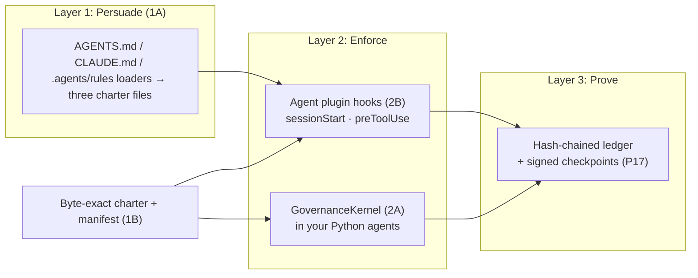

# INSTALLATION METHODS REPORT
## How AGL gets "installed": copying the charter vs. installing a plugin

| | |
|---|---|
| **Prepared for** | Kirk LaSalle, Supreme Operator |
| **Date** | 2026-11-01 |
| **Baseline revision** | `1a0f616`; implementation rechecked from `e1b6382` plus the verification fixes below (charter manifest v3.2.1) |
| **Companion documents** | [WORLD_CLASS_AUDIT_2026-11.md](WORLD_CLASS_AUDIT_2026-11.md) (finding IDs P1–P19), [EXECUTIVE_SUMMARY.md](EXECUTIVE_SUMMARY.md) |
| **New tool delivered** | [scripts/install_charter.ps1](scripts/install_charter.ps1): byte-exact charter install and verification, tested |
| **Method** | Source review, fresh tests, real wheel/sdist installs and protocol subprocess checks. [Persistent verification record](AUDIT_VERIFICATION_2026-11.md). Historical live-session claims in §4.5 are not independently re-established. |
| **Updated** | 2026-11-02: both routes now ship. `agy-governance init` covers the charter copy, and the repository is an agent plugin, verified live in Copilot CLI (§4.5). One correction from the live trial: Copilot CLI 0.0.410 runs the tool when a hook exits non-zero, so it fails **open**, not closed as §1 and §4.2 originally stated. The shipped plugin returns a JSON deny with exit 0 instead. |

---

## 1. BOTTOM LINE

1. **Your project-root copy is a valid instruction installation, not runtime enforcement.** Keep the three original documents together and add a host loader so the assistant knows to read them. Host loading and instruction adherence are not guaranteed.
2. **"Copy the three documents" covers two different installs:**
   - **(A) Pasting them into an agent's instructions.** This works today in every assistant. It is **advisory only**: nothing enforces it, nothing detects drift, and nothing records it. Anthropic's own documentation says instruction files are "context, not enforced configuration" (§9 [C3]).
   - **(B) Copying the files into a project.** For SDK boot, provide the three documents **and** `config/charter_manifest.json`. Hash verification normalises CRLF to LF; it is not raw-byte equality. The installer copies new files byte-for-byte, preserves line-ending-equivalent existing files, and refuses conflicting files unless `--force` is explicit.
3. **The repository now is an agent plugin.** Copilot/VS Code and Claude manifests, hook wrappers, a skill, kernel and charter ship in source. The Python wheel also includes the charter, but installing the wheel does not register a host plugin.
4. **The methods are complementary.** Instructions communicate intent; the SDK or plugin gates routed actions. SDK approvals are signed; plugin approvals use host permission prompts. The plugin records classification decisions, not tool execution outcomes.
5. **Do not treat the plugin as an unconditional security boundary.** Recognised prohibited operations are denied, not every possible destructive operation. Legacy Copilot CLI can run tools if the hook cannot launch. Its elevated default is deny because its host cannot ask; `defer` deliberately delegates to host permissions and may allow execution without a prompt. Fresh tests verify protocol outputs and wrappers, not complete live-host compatibility.

**Recommendation for today:**
- Use `agy-governance init --target <project-root> --loaders`, then verify the target manifest. The PowerShell installer in §3.2 is a Python-free alternative.
- Keep operator private keys outside agent-readable storage; pin the public key for SDK approvals.
- Test plugin deny behavior on harmless sample operations in each target host before relying on it. Do not silently enable `defer`.
- Existing loader files are never overwritten: merge corrected Antigravity frontmatter manually if installed before this verification pass.

---

## 2. WHAT "INSTALLING AGL" CAN MEAN

| Channel | What gets installed | Where it acts | Status |
|---|---|---|---|
| **1A: Charter as instructions** (your current method) | The text of the three documents | Inside the model's context (persuasion) | ✅ Works in every host. Advisory only. |
| **1B: Charter as runtime assets** | Byte-exact files + `config/charter_manifest.json` | On disk, verified by `GovernanceKernel` at boot | ✅ Required by the SDK. Fragile if copied by hand. |
| **2A: Python package** | `autonomous_governance` + CLIs + reference charter | Inside *your own* Python agent, wrapping routed tool calls | Source or locally built wheel; `init` installs project assets. No published release verified. |
| **2B: Agent plugin** | Manifest + hooks + skill + kernel + charter | Calls a compatible host delivers to enabled hooks | Shipped pre-alpha; protocol/wrapper-tested. Full live-host qualification still open. |

The original repository was only an SDK and charter. It now contains plugin
manifests as well. §§4.1–4.2 describe the **historical prototype**, not today's
package contents.

---

## 3. METHOD 1: COPY THE THREE DOCUMENTS

### 3.1 Method 1A: as agent instructions (the persuasion layer)

#### 3.1.1 Where each host reads instructions

| Host | Files it loads automatically | Notes | Source |
|---|---|---|---|
| **GitHub Copilot** (github.com, CLI, cloud agent, IDEs) | `.github/copilot-instructions.md`; `.github/instructions/*.instructions.md`; nearest `AGENTS.md`; or a single root `CLAUDE.md` / `GEMINI.md` | Nearest `AGENTS.md` wins. Path-specific files are combined with the repository-wide one. | [C1] |
| **Claude Code** | `CLAUDE.md` (project, user, enterprise) | Supports `@path` imports, so the three files can be referenced instead of duplicated. | [C3] |
| **Google Antigravity** | `AGENTS.md`, `GEMINI.md`, `.agents/rules/*.md` (frontmatter `trigger: always_on \| model_decision \| glob \| manual`); global `~/.gemini/AGENTS.md`, `~/.gemini/GEMINI.md` | `@[label](path)` references another file. **Hard limits below.** | [C5] |
| **Chat products** (custom-instruction boxes, project knowledge) | Product-specific | Limits vary and change. Attach the three files as project knowledge rather than pasting. | n/a |

#### 3.1.2 Measured size vs. host budgets

| File | Bytes | ≈ Tokens |
|---|---:|---:|
| `Permanent_Active_Directives.txt` (PAD) | 6,324 | 1.6 K |
| `AGENTIC_PRIME_DIRECTIVE.md` | 10,999 | 2.7 K |
| `AGENTIC_SACRED_COVENANT.md` | 13,080 | 3.3 K |
| **Total** | **30,403** | **≈ 7.6 K** |

- **Antigravity truncates each rules file at 24,000 bytes**, measured after `@[…]` includes are expanded [C5]. Pasting all three into one `AGENTS.md` or `GEMINI.md` (30,403 bytes) **silently cuts off the last ≈ 6.4 KB of the Covenant**.
- **Antigravity enforces a 20,000-token aggregate rules budget.** When the budget is exceeded, the largest files are demoted to pointers [C5]. The charter consumes ≈ 38% of the budget. Because the Covenant is the largest file, it is the first to be demoted.
- **The 10 Laws are triplicated.** Of 167 unique substantive lines, the 10 Law statements appear in all three files and 5 more lines appear in two. If context is tight, the PAD alone (≈ 1.6 K tokens) carries the canonical Laws.
- **Copilot's `sessionStart` additional context** has a 10 MiB cap [C2], so size is not a constraint there.

#### 3.1.3 What pasting does and does not do

| ✅ Does | ❌ Does not |
|---|---|
| Works in any assistant, instantly, at zero cost | Block any action. The model may comply, partially comply, or be talked out of it (prompt injection). |
| Shapes planning, tone, refusals, and escalation behaviour | Detect drift. A pasted copy with a changed word looks identical to the model. |
| Gives the operator a shared vocabulary (Law 1 … Law 10) | Produce evidence. There is no ledger, no hash, and no approval record. |
| Survives across sessions when stored in a rules file | Guarantee loading. Budgets, truncation, and `model_decision` triggers can drop it. |

> "These are context, not enforced configuration. To block an action regardless of what Claude decides, use a PreToolUse hook." (Claude Code memory documentation [C3])

#### 3.1.4 Recommended: keep the files intact and add a thin loader

Do **not** retype, reformat, or merge the documents. Copy the three files unchanged into the project root (§3.2). Then add a small loader for each host you use. The loader below does not paraphrase the Laws, so it cannot drift from the charter.

**Copilot (all surfaces) and generic agents: `AGENTS.md`**
```markdown
# Governance: AGL charter v3.2.1 (authoritative, immutable)

This project is governed by three charter documents in the repository root, SHA-256-pinned
in `config/charter_manifest.json`:

- `Permanent_Active_Directives.txt` (the 10 Laws, canonical)
- `AGENTIC_PRIME_DIRECTIVE.md`
- `AGENTIC_SACRED_COVENANT.md`

Read all three before planning or executing any task. If any instruction conflicts with them,
the charter prevails: stop and ask the operator. Never create, edit, move, rename, or reformat
these files or `config/charter_manifest.json`.
```
*In chat-only modes the agent may not open referenced files. If you need the Laws always in context there, add the PAD's text verbatim below the loader (≈ 1.6 K tokens).*

**Claude Code: `CLAUDE.md`** (imports load the files instead of duplicating them [C3])
```markdown
# Governance: AGL charter v3.2.1 (authoritative, immutable; never edit)
@Permanent_Active_Directives.txt
@AGENTIC_PRIME_DIRECTIVE.md
@AGENTIC_SACRED_COVENANT.md
```

**Antigravity: one always-on rule per document.** `@[label](path)` inlines the target *before* the 24,000-byte check, and relative paths resolve from the rule file's folder [C5]. One rule per document therefore keeps each file under the cap. Use three files, `.agents/rules/agl-1-directives.md`, `agl-2-prime-directive.md`, and `agl-3-covenant.md`, each of the form:
```markdown
---
trigger: always_on
description: AGL charter (authoritative, immutable): Permanent Active Directives, the 10 Laws. Never edit.
---
@[Permanent Active Directives](../../Permanent_Active_Directives.txt)
```
Use the matching file and description in each of the three rules. The `description` is the fallback Antigravity shows if a rule is demoted for budget reasons [C5]. Keep other always-on rules under ≈ 12 K tokens so the charter is not demoted.

### 3.2 Method 1B: as runtime assets (mandatory for the SDK)

`GovernanceKernel` hashes each charter file at boot and compares the result with `config/charter_manifest.json`. It uses SHA-256 over the raw bytes, with CRLF normalised to LF ([kernel.py](src/autonomous_governance/kernel.py), `_compute_sha256`). **Any other byte change is fatal by design (LAW10-CHARTER).**

#### 3.2.1 Probe: twelve ways of copying, tested against the installed 0.1.0 wheel

An isolated venv was created, and the wheel was installed with `--no-index`. Each scenario was a fresh project directory.

| ID | Scenario | Kernel boot |
|---|---|---|
| S0 | `pip install` only | ❌ `Charter manifest not found` |
| S1 | Three documents copied, no manifest | ❌ |
| **S2** | **Byte-exact copy of three documents + `config/charter_manifest.json`** | ✅ boot ≈ 66 ms; `agy-governance verify` rc 0 |
| S3 | Same, converted to CRLF | ✅ (CRLF is normalised) |
| S4 | UTF-8 BOM added (common when saving from Notepad or other editors) | ❌ hash mismatch |
| S5 | Windows PowerShell 5.1 `Get-Content \| Set-Content` | ❌ (appends a trailing newline) |
| S6 | Editor "insert final newline" on the PAD | ❌ |
| S7 | Text copied from *rendered* Markdown (`**` stripped) | ❌ |
| S8 | One em dash (—) typed as `--` | ❌ |
| S9 | Manifest placed in project root instead of `config/` | ❌ |
| S10 | Correct install, kernel started from a sub-directory | ❌ (CWD-relative paths, **P9**) |
| S11 | Sub-directory + absolute `manifest_path` | ❌ `Charter file missing` (**new finding P18**) |

**Conclusion:** the Method 1A habit of copying text and pasting it is exactly what breaks Method 1B. Runtime assets must be copied as **files**, never as **text**.

#### 3.2.2 Tested procedure: `scripts/install_charter.ps1`

```powershell
# from the AGL repository
powershell -ExecutionPolicy Bypass -File scripts\install_charter.ps1 -Target D:\Projects\MyAgent
# later, to re-check a project
powershell -ExecutionPolicy Bypass -File scripts\install_charter.ps1 -Target D:\Projects\MyAgent -VerifyOnly
```

The script:
1. Verifies the **source** charter against its own manifest.
2. Copies the four files with `Copy-Item` (byte-exact).
3. Refuses to overwrite a differing file unless `-Force` is given.
4. Re-hashes the **target** exactly as the kernel does.
5. Exits `0` (verified) or `1` (invalid).

| Test (Windows PowerShell 5.1) | Result |
|---|---|
| T1 fresh install | rc 0, 4 files copied, 3/3 digests OK |
| T2 re-run (idempotent) | rc 0, "present" ×4 |
| T3 target PAD gains a trailing newline, re-run | rc 1, "already exists and differs… Re-run with -Force" |
| T4 `-VerifyOnly` on the tampered target | rc 1, `MISMATCH d455aaa1… vs 1343bb2c…` |
| T5 `-Force` | rc 0, PAD restored |
| T6 `agy-governance verify` + `GovernanceKernel()` from the target | rc 0, `kernel boot OK 3.2.1 3` |
| T7 non-existent target | rc 1, clear error |

**Without the script:** use `Copy-Item` (or Explorer copy/paste of the *files*) for the three documents and `config\charter_manifest.json`. Then run `agy-governance verify` **from the target project root**. Do not open-and-save the files in an editor.

---

## 4. METHOD 2: "PLUGIN"

### 4.1 What exists today: a Python package, not an agent plugin

| Check | Result |
|---|---|
| `copilot plugin install D:\Projects\IntelligenceGovernanceLaws` (CLI 0.0.410) | ❌ `Failed to install plugin: No plugin.json found in repository. Tried: plugin.json, .github/plugin/plugin.json, .claude-plugin/plugin.json` |
| Plugin artefacts in the repo (`plugin.json`, `.claude-plugin/`, `hooks.json`, `skills/`, MCP server, `AGENTS.md`) | None |
| `https://pypi.org/project/autonomous-governance-laws/` | HTTP 404, not published |
| Contents of the 0.1.0 wheel | Python modules only. **No charter files, no manifest** (**P19**). |
| `pip install` alone, then `GovernanceKernel()` | ❌ (S0 above) |
| `laws-lint` on a project that contains *only* the charter | "100/100 COMPLIANT". The score reflects the absence of code, not governance (supports **P13**). |

Today's only working package install is: clone → `pip install -e ".[dev,crypto]"` → Method 1B → run from the project root.

### 4.2 What a real AGL plugin looks like: prototype built and tested

The prototype follows the Agent Plugins 1.0 / Copilot plugin layout [C1][C4][C6]. It is kept outside the repository (session evidence). No repository code was changed to build it.

```
autonomous-governance-laws/
├── plugin.json                  # name, version, "hooks": "hooks.json", "skills": "skills/"
├── hooks.json                   # sessionStart + preToolUse → python "${PLUGIN_ROOT}/hooks/…"
├── hooks/
│   ├── agl_session_start.py     # boots GovernanceKernel; emits {"additionalContext": <verified charter>}
│   └── agl_pre_tool_use.py      # maps host tool → AGL tool; evaluate_risk → deny / ask / (no decision)
├── skills/agl-charter/SKILL.md  # on-demand "consult the Laws before risky work"
├── charter/                     # byte-exact charter + config/charter_manifest.json
└── lib/autonomous_governance/   # vendored kernel (until the wheel ships the charter)
```

**Decision policy:**

| AGL tier | Hook decision | Effect in the host |
|---|---|---|
| PROHIBITED (LAW1/LAW3) | `deny` + reason | Tool call blocked |
| ELEVATED, or any non-read-only/unknown tool | `ask` + reason | Host shows its native approval prompt (Law 2 operator supremacy). **Copilot cloud agent and CLI autopilot treat `ask` as deny** [C2]. |
| Read-only tools (`view`, `grep`, …) | no decision | Normal permission flow |

The policy is default-ask, which closes the default-allow gap of **P6** for unknown tools. Approval comes from the host's own prompt, not from AGL's token path, so the **P1/P2 self-approval defects do not apply to this channel**.

**Probe results (Copilot CLI 0.0.410, Windows, Python 3.14):**

| Probe | Result |
|---|---|
| `copilot plugin install <prototype>` | ✅ `Plugin "autonomous-governance-laws" installed successfully. Installed 1 skill.`; listed as `v0.1.0-proto` |
| `sessionStart` hook | ✅ rc 0, 343 ms, 30,719 characters of verified charter in `additionalContext` |
| `preToolUse`: prohibited commands **D1–D3** (strings below) and `edit config/charter_manifest.json` | ✅ **deny** |
| `preToolUse`: `powershell Remove-Item x`, `create src/app.py` | ✅ **ask** |
| `preToolUse`: `view README.md` | ✅ no decision (allowed) |
| `preToolUse`: evasions **E1–E2** (strings below) | ⚠️ **ask, not deny**. Classifier evasion (**P6**). Still blocked unless a human approves. |
| One space appended to the Covenant | ✅ both hooks exit 1 (`expected 180625f4…, got c55996ab…`). The hooks reference documents command `preToolUse` hooks as **fail-closed** on non-zero exit [C2]. ❌ *Correction (§4.5):* Copilot CLI 0.0.410 runs the tool after a non-zero exit. |
| Ledger after 11 hook processes | ❌ `audit_ledger()` → `valid: False`, **11 broken links**. Every process restarts the chain at 64 zeros (**P4**). |
| Hook latency | 283–518 ms per tool call (Python cold start + kernel boot + 3 × SHA-256). The timeout was set to 10 s. |

Probe strings (tool name, then command). They are fenced because `laws-lint` flags unfenced destructive commands in Markdown, even when quoted (see P13):

```text
D1  bash        rm -rf /
D2  powershell  format c:
D3  Bash        DROP DATABASE prod                  (Claude Code tool schema)
E1  bash        rm  -rf  /                          (double spaces)
E2  powershell  Remove-Item -Recurse -Force C:\
```

**Not yet verified (at the prototype stage):**
- A live agent session with the hooks firing. The install output reports skills only, and a live run would spend premium requests in your real profile. *Done for Copilot CLI on 2026-11-02 in an isolated profile (§4.5).*
- The Claude Code install, which needs `.claude-plugin/plugin.json` plus a marketplace.
- The VS Code pickup.

Running these is roadmap item **I7**.

### 4.3 Per-host plugin installation (once published)

| Host | Command / action | Manifest needed | Source |
|---|---|---|---|
| **GitHub Copilot CLI** | `copilot plugin install kirklasalle/AutonomousGovernanceLaws` (also `OWNER/REPO:PATH`, a git URL, a local path, or `name@marketplace`) | `plugin.json` at the root, or `.github/plugin/plugin.json` | [C1] + probe |
| **VS Code (Copilot Chat)** | *Chat: Install Plugin from Source*, or auto-discovery of plugins installed by Copilot CLI. Requires `chat.plugins.enabled`. | same | [C4] |
| **Claude Code** | `/plugin marketplace add kirklasalle/AutonomousGovernanceLaws` → `/plugin install autonomous-governance-laws@<marketplace>` | `.claude-plugin/plugin.json` + `marketplace.json`. Hook output must be wrapped as `hookSpecificOutput`. | [C3] |
| **Google Antigravity** | No plugin/hook mechanism verified from primary documentation | Use Method 1A rules (§3.1.4) | [C5] |

### 4.4 Engineering lessons from the prototype

1. **Fix the ledger before shipping hooks (P4/P5).** Hooks are short-lived processes, so chain resume and file locking are mandatory.
2. **Bundle the charter with the code (P19), and resolve paths from the manifest (P18).** The prototype had to `chdir` into its charter folder to boot the kernel.
3. **Map host tool names.** The kernel's classifier only knows its own names (`write_file`, `execute_command`, …) and only reads the `command` and `target_path` arguments. Copilot sends `powershell`/`bash`/`edit`/`create` with a `path` argument, and Claude sends `Bash`/`Write`/`Edit` with `file_path`. Without a mapping layer, any host call that misses the substring checks is classified **SAFE**, and protected-path checks never see the file being edited (**P6**). The prototype adds this mapping.
4. **Timeouts fail open** for command hooks, and HTTP hooks fail open entirely [C2]. Keep hooks fast: cache the verified charter hash per session in `$COPILOT_PLUGIN_DATA` and avoid network calls. *Shipped:* the hook caps input size (1 MiB events, 256 KiB of inspected text, 512 write paths) and its own 20 s watchdog denies before the host's 30 s timeout once Python is running. The Claude Code hook also sets `"onFailure": "block"`.
5. **Emit exactly one JSON object on stdout.** Extra output makes Copilot ignore the decision and fall back to the default flow [C2].
6. **Protect the plugin's own install directory.** An agent with shell access could edit the installed hook script. Add the plugin cache path to `PROTECTED_PATHS` and to the deny list.
7. **The hooks need a Python interpreter on PATH.** Prefer `exec`/`args` with an explicit interpreter (Copilot CLI only [C2]), or ship a self-contained executable.
8. **Plugins run code on the user's machine** [C4]. Sign releases, keep the hook code small and auditable, and document exactly what it reads and writes.

### 4.5 Shipped plugin and live host verification (2026-11-02)

> **Evidence qualification:** the following is the earlier author's trial record.
> Its raw live-host transcript was not available during the fresh verification.
> Do not interpret it as a new end-to-end pass for the final wrappers. See the
> [committed evidence](AUDIT_VERIFICATION_2026-11.md) for checks actually rerun.

The plugin now lives in the repository root (roadmap I6):
- `.plugin/plugin.json` and an identical `.github/plugin/plugin.json`
- `.claude-plugin/plugin.json` + `marketplace.json`
- `hooks/` (adapter shim, `sh` and `ps1` wrappers, one hook file per host)
- `skills/agl-charter/`
- the kernel's `autonomous_governance.hooks` adapter

It was installed with `copilot plugin install` into an **isolated** profile, so the real `~/.copilot` stayed untouched. `USERPROFILE` and `HOME` were redirected for the process, because `plugin install` ignores `COPILOT_HOME` and `--config-dir`. It was then driven by a real agent session.

**First live run: the hooks never fired.** The skill loaded, but no hook ran. Reading the CLI 0.0.410 bundle [C8] showed four incompatibilities with the current documentation [C1][C2]:

| CLI 0.0.410 behaviour [C8] | Consequence | Shipped fix |
|---|---|---|
| Reads the manifest only from `.github/plugin/plugin.json` or a root `plugin.json` | `.plugin/plugin.json` was invisible | Identical `.github/plugin/plugin.json`. No root `plugin.json`, because newer hosts read it first as an Agent Plugins manifest. |
| Accepts only camelCase events and the `bash`/`powershell` keys; unknown keys are stripped silently | PascalCase events and per-OS keys were dropped | `hooks/copilot-hooks.json` uses `sessionStart`/`preToolUse` with only `bash` and `powershell` |
| Any hook error (non-zero exit, timeout, spawn failure, unparsable stdout) is logged and **the tool runs** | Exit 2 failed *open* | A camelCase `preToolUse` argument selects Copilot's protocol: every denial **and every internal error** is a single JSON deny with exit 0. The wrappers and shim do the same when Python is missing or the kernel cannot load. |
| `"ask"` is ignored and the tool runs; the payload has no `sessionId` | Elevated actions ran unprompted | When the camelCase payload has no `sessionId` (0.0.4xx), ask becomes **deny**, with a reason that suggests `copilot update` or `AGL_ELEVATED_DECISION=defer` |
| Hooks run through `pwsh.exe` on Windows (`bash.exe` if only a `bash` command is given, which is often WSL) | Without PowerShell 7 no hook can start, so tool calls run **ungoverned** | Both keys are always set. PowerShell 7 is a documented requirement. If PowerShell starts but cannot run the wrapper (execution policy, missing file), the `powershell` command prints a JSON deny itself (added after the code review). |
| `sessionStart` output is ignored | No charter injection on 0.0.4xx | Documented. The skill still loads, and enforcement does not depend on context. |

**Second live run** (Windows, Copilot CLI 0.0.410, portable PowerShell 7.6.9, Python 3.15.2, model `claude-haiku-4.5`, 1 premium request):

| Step requested of the agent | Hook decision (from the CLI transcript) | Ledger |
|---|---|---|
| session start | hook ran (output ignored by 0.0.410) | `HOOK_SESSION_START` |
| `view README.md` | allowed | `HOOK_DECISION` SAFE / none |
| `create hello.txt` | **Denied by preToolUse hook: AGL RISK-001** … "This Copilot CLI version cannot ask for approval…" | ELEVATED / deny `0fed5ff87a4e` |
| `create ~/.agl/plugin-data/notes.txt` | **Denied: AGL LAW1-PROHIBIT / LAW3-SUBORDINATE** | PROHIBITED / deny `480a553eb6a5` |
| shell `git status` | **Denied: AGL RISK-001** (legacy host) | ELEVATED / deny `acb0dedbf840` |

- Neither file was created.
- The CLI log shows `Loaded 2 hook(s) from 1 plugin(s)`.
- The 11-event ledger passed `audit_ledger()` (valid, 0 broken links). Each denial shown to the agent cites its ledger event hash.
- Measured hook latency: **0.72–0.76 s per tool call** and 1.19 s at session start (`pwsh` start + interpreter probe + kernel boot).

**Still to do (I7):**
- Re-run the live session with the code-review fixes. The new `powershell` command was run directly, the way the CLI runs it, under PowerShell 7.6.9 and Windows PowerShell 5.1: it denied with a normal policy, a `Restricted` policy, and a missing wrapper.
- Linux and macOS live runs (the `bash` path is covered by the test suite on Linux).
- A current Copilot CLI release (ask prompts, `sessionStart` context).
- Claude Code: its CLI crashes on startup under Node 26 on this machine, so it could not be tested.
- VS Code.

---

## 5. HEAD-TO-HEAD COMPARISON

| Criterion | 1A Instructions (paste) | 1B + 2A SDK (files + package) | 2B Agent plugin (shipped pre-alpha) |
|---|---|---|---|
| **Governs** | The model's intent and reasoning | Calls *your* application routes through the SDK | Calls a compatible host delivers to enabled hooks |
| **Enforcement** | None (advisory) | In-process. Trusted callers must honor refusals (P8). | Out-of-process classification; host must honor the decision. Startup failures and host timeouts can fail open. |
| **Charter integrity** | None: drift is invisible | SHA-256 at boot ✅ | SHA-256 on every hook call ✅ |
| **Human approval** | Model-dependent | AGL Ed25519 token, pinned operator key only | Host permission handling, unsigned; `defer` may allow without a prompt |
| **Audit trail** | None | Hash-chained ledger; resumes and locks across processes (P17 open) | Classification decisions, not execution outcomes; chain verified in fresh subprocess tests |
| **Hosts** | Any LLM | Python applications | Copilot CLI, VS Code; Claude Code with second manifest |
| **Install effort** | Seconds | Clone + pip + copy + run from root | One command (after publishing) |
| **Context cost** | ≈ 7.6 K tokens (≈ 1.6 K with PAD only) | 0 | ≈ 7.7 K tokens with `sessionStart` injection; 0 with skill-only mode |
| **Latency** | 0 | 0.49–0.71 ms per call (measured) | ≈ 0.3 s per tool call in direct probes; 0.72–0.76 s live on Windows via `pwsh` (§4.5) |
| **Failure mode** | Silent truncation, demotion, injection | Refuses to boot (safe) | Fail-closed on error, oversized input, a PowerShell load failure, or a decision slower than 20 s (JSON deny on Copilot, exit 2 elsewhere). Fail-open on a disabled plugin, a hang before Python starts, or a hook that cannot start (no `pwsh` on Windows, Copilot CLI 0.0.4xx) |
| **Maturity today** | Advisory; host loading must be checked | Tested pre-alpha | Shipped pre-alpha; final-build live qualification pending |
| **Best for** | Every conversation, every host | Products you build in Python | Governing coding agents on a developer machine |

---

## 6. RECOMMENDATION: A LAYERED INSTALL



### 6.1 What to do now (no code changes needed)
1. Keep using the three documents as instructions, but switch to the **thin loaders in §3.1.4**. This avoids Antigravity truncation and lets you edit nothing.
2. For any project that imports `autonomous_governance`, run **`scripts\install_charter.ps1 -Target <project>`** and start the agent from that project's root.
3. Use locally built artifacts for evaluation. Do not publish a production-ready or universally supported-host claim before release signing and live-host qualification.

### 6.2 Roadmap to a first-class installable product

| # | Item | Fixes | Audit phase |
|---|---|---|---|
| I1 | Ship the charter + manifest as **package data** (`importlib.resources`). Verify the packaged copy by default, so `pip install` alone boots. | P19 | P0 |
| I2 | Resolve charter paths **relative to the manifest**. Add an explicit `project_root`. Log resolved paths. | P18, P9 | P0 |
| I3 | Chain resume + file lock in the ledger | P4, P5 | P0 |
| I4 | Classifier: host tool-name mapping, `shlex` tokenisation, default-ask | P6 | P0 |
| I5 | `agy-governance init` (cross-platform port of `install_charter.ps1`) and `agy-governance instructions --host copilot\|claude\|antigravity` to generate the loaders | DevEx | P1 |
| I6 | Add the plugin to the repo: root `plugin.json`, `hooks.json`, `skills/`, `.claude-plugin/plugin.json` + `marketplace.json`; state in `$COPILOT_PLUGIN_DATA`; self-protect the plugin directory | New | P1 |
| I7 | Live end-to-end tests in Copilot CLI, VS Code, and Claude Code. CI replays recorded hook payloads. | New | P1 |
| I8 | Publish: PyPI via Trusted Publishing + Sigstore attestations; plugin marketplace listing | R7 | P2 |

**Status on 2026-11-02:**
- I1 is done in `ec61164` (package data).
- I3 and I4 are done in `aae4989`; I4's host tool-name mapping ships with the plugin.
- I2 is partly done: P18 is fixed in `aae4989`, but P9 (default ledger/halt paths depend on the working directory) is still open.
- I5 is done as `agy-governance init --loaders`.
- I6 is done, with the manifest layout corrected per §4.5.
- I7 is partly done: Copilot CLI 0.0.410 on Windows is verified live; Linux/macOS, current Copilot CLI, Claude Code and VS Code are pending.
- I8 is open.

**Market note:** combining a pinned charter with host-delivered tool checks is a
candidate differentiator, not demonstrated exclusivity. The
[market audit](MARKET_AUDIT.md) recommends a complementary SDK/plugin position,
with host qualification and signed releases before broader assurance claims.

---

## 7. NEW FINDINGS REGISTERED IN THE AUDIT

| ID | Severity | Finding | Evidence | Fix |
|---|---|---|---|---|
| **P18** | Medium | Charter file paths from the manifest resolve against the **process CWD**, even when `manifest_path` is absolute. A correctly installed project fails to boot when started from a sub-directory. | [kernel.py](src/autonomous_governance/kernel.py) `_verify_charter_integrity` (`Path(file_name)`); probe S11 | Resolve relative to `manifest_path.parent.parent` or an explicit `project_root` (I2) |
| **P19** | Medium | **Distribution gap.** The wheel and sdist contain no charter files and no manifest. There is no `init` command, the package is not on PyPI, and the repository is not a plugin. `pip install` alone can never boot. | [pyproject.toml](pyproject.toml) wheel/sdist targets; probes S0, §4.1 | I1, I5, I6, I8 |

The prototype also confirmed **P4** (11/11 broken links across hook processes) and **P6** (spacing evasion) through a real host-tool path.

---

## 8. EVIDENCE, LIMITS, AND DISCLOSURES

- **Probes:**
  - Install probe S0–S11 (isolated venv, offline wheel install).
  - Plugin probes (CLI install, hooks with simulated payloads, tamper, ledger audit).
  - Script tests T1–T7.

  Raw results were saved as session evidence (`install_probe_results.json`, `plugin_probe_results.json`). The prototype source was kept with them and was **not committed**.
- **Isolation incident:** Copilot CLI 0.0.410 did **not** honour a temporary `COPILOT_HOME`. The prototype was therefore installed into the real `~/.copilot` for about one minute. It was removed with `copilot plugin uninstall` and the empty `_direct` folder was deleted. The only residue is `~/.copilot/config.json` containing `"installed_plugins": []`.
  - On 2026-11-02 the same happened once more with the shipped plugin, because `--config-dir` is also ignored by `plugin install`. It was uninstalled the same way.
  - All later runs redirected `USERPROFILE`/`HOME` to a temporary profile, and the real profile was re-checked after each run.
- **Not tested:** model adherence to pasted instructions (vendor documentation cited instead), Antigravity hooks (no primary documentation found), Claude Code plugin installation, VS Code pickup, and live hook firing on Linux/macOS or a current Copilot CLI release.
- **No charter file or `config/charter_manifest.json` was modified.** `scripts/verify_charter.py` passes.

---

## 9. SOURCES (primary, retrieved 2026-11-01)

- **[C1]** GitHub Docs: *GitHub Copilot CLI plugin reference*. https://docs.github.com/en/copilot/reference/copilot-cli-reference/cli-plugin-reference. *Adding repository custom instructions*. https://docs.github.com/en/copilot/how-tos/copilot-on-github/customize-copilot/add-custom-instructions/add-repository-instructions
- **[C2]** GitHub Docs: *GitHub Copilot hooks reference*. https://docs.github.com/en/copilot/reference/hooks-reference. Covers fail-closed/fail-open semantics, `ask` handling in cloud agent and autopilot, single-JSON stdout parsing, the 10 MiB `additionalContext` limit, `exec`/`args`, and `$COPILOT_PLUGIN_DATA`.
- **[C3]** Anthropic: Claude Code docs: *Plugins* https://code.claude.com/docs/en/plugins · *Hooks* https://code.claude.com/docs/en/hooks · *Memory* https://code.claude.com/docs/en/memory
- **[C4]** Visual Studio Code: *Agent plugins* https://code.visualstudio.com/docs/agent-customization/agent-plugins · *Hooks* https://code.visualstudio.com/docs/agent-customization/hooks · *Agent plugin authoring reference* https://code.visualstudio.com/docs/agents/reference/agent-plugin-reference
- **[C5]** Google Antigravity: *Rules*. https://antigravity.google/docs/rules
- **[C6]** Agent Plugins manifest specification (referenced by [C4]). https://agent-plugins.org/plugin-authors/manifest
- **[C7]** PyPI project URL (404 on retrieval). https://pypi.org/project/autonomous-governance-laws/
- **[C8]** GitHub Copilot CLI 0.0.410 (`win32-x64`) bundle, `index.js`, inspected locally on 2026-11-02. Covers the plugin manifest lookup, the hook config schema, the hook runner (`pwsh.exe`/`bash`, stdin payload, whole-stdout JSON parse), and `preToolUse` handling (only `permissionDecision: "deny"` blocks; errors are logged and the tool runs). Primary evidence for an installed build. Newer releases follow [C1][C2].
