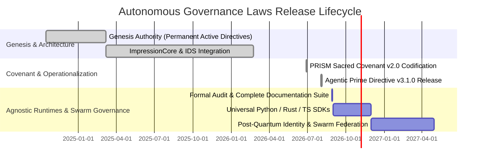

# PRODUCT REQUIREMENTS DOCUMENT (PRD)
## Autonomous Governance Laws: Constitutional Runtime & Policy Framework

**Document Version:** 2.1.0  
**Status:** Approved & Binding  
**Author:** Kirk LaSalle (Founder & Supreme Operator)  
**Co-Authors & Contributors:** Claude (Anthropic), Antigravity AI  
**Scope:** Universal Autonomous Agent Runtimes, Multi-Agent Swarms, and Governance Telemetry  

---

## 1. VISION & PURPOSE

### 1.1. Executive Summary
As autonomous artificial intelligence agents gain the capability to control operating systems, write code, invoke APIs, execute financial transactions, and coordinate in distributed swarms, conventional alignment mechanisms (such as prompt instructions and post-hoc evaluation) are mathematically and architecturally insufficient.

The **Autonomous Governance Laws Framework** provides an immutable, cryptographically verifiable, and runtime-enforced constitutional architecture. Rooted in Kirk LaSalle’s **10 Laws for Intelligence Systems**, this framework transforms ethical principles from subjective conversational suggestions into deterministic runtime gates, append-only ledgers, and operator-supreme approval pipelines.

### 1.2. Strategic Objectives
- **Zero-Bypass Policy Enforcement:** Ensure no autonomous tool invocation or system mutation occurs without passing through a multi-tier governance interceptor.
- **Cryptographic Immutability:** Bind charter definitions and operational policies to Ed25519 digital signatures and SHA-256 Merkle hashes.
- **Operator Supremacy:** Guarantee that the human operator retains absolute, unbypassable authority to inspect, constrain, approve, or instantly halt any autonomous process.
- **Radical Observability:** Maintain an append-only, tamper-evident audit ledger that survives process rollbacks and system crashes.
- **Framework Agnosticism:** Deliver an abstract governance architecture that integrates natively across any agent runtime (PRISM Refraction, LangGraph, AutoGen, CrewAI, custom C++/Rust/Go kernels).

---

## 2. STAKEHOLDERS & AUTHORITY HIERARCHY

```
┌─────────────────────────────────────────────────────────────────────────────┐
│                           SUPREME OPERATOR (Kirk LaSalle)                   │
│          • Holds Root Ed25519 Governance Key                                │
│          • Supreme Human Governing Authority (Supersedes all systems)       │
└──────────────────────────────────────┬──────────────────────────────────────┘
                                       │
                                       ▼
┌─────────────────────────────────────────────────────────────────────────────┐
│                       INTELLIGENCE GOVERNANCE COUNCIL                       │
│          • Constitutional Amendment Approval                                │
│          • Policy Registry Attestation & Emergency Exception Handling        │
└──────────────────────────────────────┬──────────────────────────────────────┘
                                       │
        ┌──────────────────────────────┴──────────────────────────────┐
        ▼                                                             ▼
┌──────────────────────────────┐              ┌──────────────────────────────┐
│    AUTONOMOUS RUNTIME KERNEL │              │    HUMAN USERS & BENEFICIARIES│
│ • Intercepts all Tool Calls  │              │ • Protected by 10 Laws       │
│ • Manages Append-Only Ledger │              │ • Enjoy Growth & Prosperity  │
│ • Enforces Operator Halts    │              │ • Sovereign Data Ownership   │
└──────────────────────────────┘              └──────────────────────────────┘
```

### Stakeholder Personas

1. **The Supreme Operator (Kirk LaSalle):**
   - Retains supreme governing authority over all system behaviors, goal allocations, and security boundaries.
   - Holds primary cryptographic signing keys for configuration attestation and amendment ratification.

2. **The Autonomous Agent / Multi-Agent Swarms:**
   - Autonomous entities executing tasks, planning multi-step actions, and invoking system tools.
   - Bound completely by the 10 Laws, unable to bypass policy interceptors or alter governance ledgers.

3. **Systems Engineers & Integrators:**
   - Developers deploying agentic runtimes into cloud, edge, or on-premise infrastructure.
   - Responsible for instrumenting tool gates, CI digest pins, and telemetry streams.

4. **Human Users & End-Beneficiaries:**
   - Individuals interacting with agent applications. Guaranteed non-harm, non-deception, privacy protection, and equity.

---

## 3. FUNCTIONAL REQUIREMENTS (FR)

```
┌─────────────────────────────────────────────────────────────────────────────┐
│                     FUNCTIONAL REQUIREMENTS MATRIX (FR)                     │
├────────┬───────────────────────────────────┬──────────────┬─────────────────┤
│ ID     │ Requirement Name                  │ Law Ref      │ Verification ID │
├────────┼───────────────────────────────────┼──────────────┼─────────────────┤
│ FR-01  │ Charter Digest Verification       │ Law 10       │ LAW10-CHARTER   │
│ FR-02  │ Cryptographic Config Attestation  │ Law 10       │ LAW10-APPROVAL  │
│ FR-03  │ 3-Tier Policy Risk Interceptor    │ Law 1, Law 6 │ RISK-001        │
│ FR-04  │ Non-Bypassable Prohibitions       │ Law 1, Law 7 │ LAW1-PROHIBIT   │
│ FR-05  │ Emergency Operator Halt           │ Law 2        │ LAW2-HALT       │
│ FR-06  │ Subordinate Self-Constraint       │ Law 3        │ LAW3-SUBORDINATE│
│ FR-07  │ Cross-System Guarding             │ Law 4        │ LAW4-DELEGATE   │
│ FR-08  │ Append-Only Telemetry Ledger      │ Law 9        │ LAW9-LEDGER     │
│ FR-09  │ Graceful Foundational Fallback    │ Law 9        │ LAW9-FALLBACK   │
│ FR-10  │ Unauthorized Spawn Lockout        │ Law 10       │ LAW10-SPAWN     │
└────────┴───────────────────────────────────┴──────────────┴─────────────────┘
```

### Detailed Functional Specifications

#### FR-01: Charter Digest Verification (`LAW10-CHARTER`)
- **Description:** The system must compute the SHA-256 hash of all canonical charter documents (`Permanent_Active_Directives.txt`, `AGENTIC_PRIME_DIRECTIVE.md`, `AGENTIC_SACRED_COVENANT.md`) at boot time and verify them against `config/charter_manifest.json`.
- **Pass Criteria:** If any charter document is missing, altered, reordered, or modified by even one byte, runtime initialization MUST fail immediately with an unrecoverable error.

#### FR-02: Cryptographic Configuration Attestation (`LAW10-APPROVAL`)
- **Description:** All active governance parameters, resource caps, and tool permissions must be bundled into a manifest signed by an authorized operator Ed25519 private key.
- **Pass Criteria:** When `governance.require_attestation` is enabled, the runtime MUST refuse to boot or process tasks if the signature is invalid or unsigned.

#### FR-03: 3-Tier Policy Risk Interceptor (`RISK-001`)
- **Description:** Every proposed tool action, OS command, file mutation, or network request MUST be classified into one of three tiers:
  1. `TIER 1 (SAFE):` Non-mutating reads, diagnostic telemetry. Executed immediately.
  2. `TIER 2 (ELEVATED RISK):` File writes, state updates, network calls, resource allocation. Requires an action-bound Single-Use Approval Token.
  3. `TIER 3 (PROHIBITED):` Destruction of ledgers, key tampering, prompt injection attacks, physical safety violations. Dropped unconditionally.

#### FR-04: Non-Bypassable Prohibitions (`LAW1-PROHIBIT`)
- **Description:** Prohibited actions cannot be approved even if a human operator issues a prompt requesting it, if that action violates Law 1 (Human preservation and non-harm) or Law 5 (Assumption of human judicial power).
- **Pass Criteria:** Policy engine blocks prohibited actions with hard code drops regardless of input context.

#### FR-05: Emergency Operator Halt (`LAW2-HALT`)
- **Description:** The system must monitor an out-of-band killswitch mechanism (e.g., `.halt` file touch, IPC interrupt signal, or API emergency webhook).
- **Pass Criteria:** Upon receiving a halt trigger, all active agent execution threads MUST terminate within 50 milliseconds, persisting all state to the append-only ledger before process exit.

#### FR-06: Subordinate Self-Constraint (`LAW3-SUBORDINATE`)
- **Description:** An agent runtime is strictly prohibited from modifying its own policy registry, binary executables, ledger logs, attestation keys, or halt trigger paths.
- **Pass Criteria:** File system hooks block write/delete operations targeting `config/`, `.ledger/`, or key storage paths by agent execution contexts.

#### FR-07: Cross-System Guarding (`LAW4-DELEGATE`)
- **Description:** When an agent delegates sub-tasks to child agents, legacy scripts, or external APIs, the parent agent MUST pass Character Accountability Control (CAC) tokens and enforce identical governance boundaries on the child process.

#### FR-08: Append-Only Telemetry Ledger (`LAW9-LEDGER`, `LAW9-APPEND`, `LAW9-CHAIN`)
- **Description:** Every agent action, decision step, tool invocation, policy refusal, and operator override MUST be recorded in a SHA-256 hash-chained JSONL/Merkle log.
- **Pass Criteria:** The ledger must be immutable. Rollback of an environment state MUST NOT erase or rewrite the audit ledger events describing the failed action.

#### FR-09: Graceful Foundational Fallback (`LAW9-FALLBACK`)
- **Description:** When complex neural reasoning or multi-agent swarm consensus encounters high entropy, contradictory constraints, or unverifiable outputs, the system MUST fallback to a simple, deterministic, minimal diagnostic state.
- **Pass Criteria:** The agent announces the verification failure transparently and reverts to basic operator-guided diagnostic mode.

#### FR-10: Unauthorized Spawn Lockout (`LAW10-SPAWN`)
- **Description:** Autonomous sub-agent generation (`fork()`, `spawn_agent()`, `sub_agent()`) MUST require an explicit, unexpired, cryptographic spawn token issued by the Governance Engine.
- **Pass Criteria:** Unsigned spawn attempts throw immediate `GovernanceViolation` and terminate the offending branch.

---

## 4. NON-FUNCTIONAL REQUIREMENTS (NFR)

### 4.1. Performance & Latency
- **NFR-01 (Interception Overhead):** Policy evaluation for Tier 1 and Tier 2 actions must introduce no more than **2.5 milliseconds** of latency to the tool invocation lifecycle.
- **NFR-02 (Ledger Write Throughput):** Telemetry writes must support up to **10,000 events/second** utilizing asynchronous, non-blocking disk flush buffers.

### 4.2. Security & Tamper Resistance
- **NFR-03 (Asymmetric Cryptography):** Ed25519 curve signatures for configuration attestation; SHA-256 for all event hashing and Merkle trees.
- **NFR-04 (Fail-Closed Default):** If any policy check times out, encounters an unhandled exception, or loses connection to the attestation registry, the runtime MUST fail closed (refuse execution).

### 4.3. Quantum-Resistant Identity Preparedness
- **NFR-05 (Post-Quantum Crypto Migration):** Architecture must support modular abstraction for future migration to NIST-approved post-quantum algorithms (ML-DSA / Dilithium, Falcon) for digital identity imprints.

---

## 5. SCOPE & EXPLICIT RUNTIME GAP DISCLOSURE

In accordance with Article III, Section 3.1 of `AGENTIC_SACRED_COVENANT.md`, this PRD mandates total transparency regarding the system’s current mathematical and runtime boundaries:

| Law | Governing Concept | Runtime Status | Implementation Boundary |
|:---:|---|:---:|---|
| **Law 1** | Human Preservation & Safety | **Enforced** | Deterministic tool filter (`RISK-001`, `LAW1-PROHIBIT`) |
| **Law 2** | Operator Obedience | **Enforced** | Immediate signal halt (`LAW2-HALT`) |
| **Law 3** | Subordinate Self-Defense | **Enforced** | Path isolation (`LAW3-SUBORDINATE`) |
| **Law 4** | Cross-System Enforcement | **Enforced** | Context token inheritance (`CAC-001`) |
| **Law 5** | Judicial Power Prohibition | **Declarative Policy** | *No automated judicial-overreach detector exists. Enforced via system prompt & API scope constraints.* |
| **Law 6** | Data Privacy & Ownership | **Enforced** | Sandboxed I/O & vault credential injection |
| **Law 7** | Truthfulness & Non-Deception | **Enforced** | Deterministic telemetry instrumentation |
| **Law 8** | Equity & Neutrality | **Declarative Policy** | *No real-time bias mathematical model is embedded at kernel level. Enforced via policy rules.* |
| **Law 9** | Verifiable Ledger & Fallback | **Enforced** | SHA-256 append-only chained logs (`LAW9-LEDGER`) |
| **Law 10**| Boundaries & Non-Replication | **Enforced** | Ed25519 attestation & spawn gates (`LAW10-APPROVAL`) |

---

## 6. RELEASE LIFECYCLE & ROADMAP



---
*Product Requirements certified by Kirk LaSalle and the Advanced Agentic Architecture Council.*
