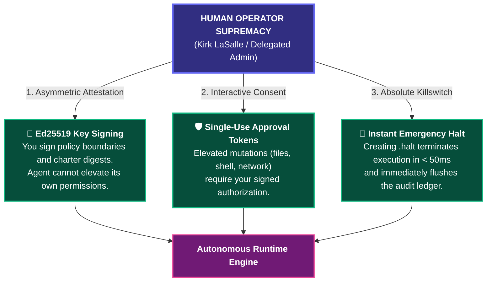
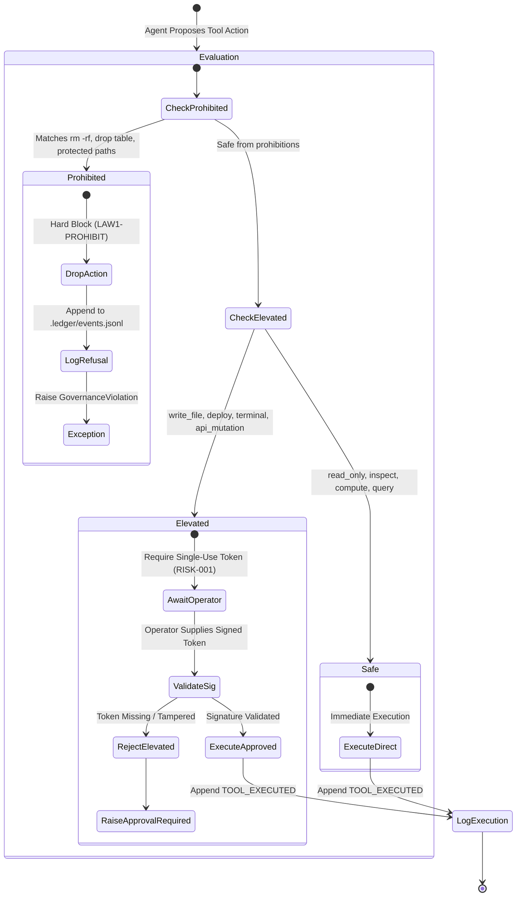
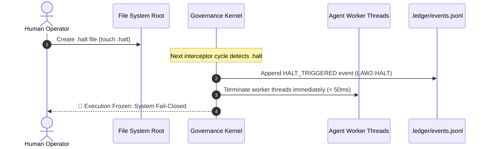

# USER & OPERATOR GOVERNANCE HANDBOOK
## Operating Autonomous AI Systems Under the Autonomous Governance Laws

**Audience:** Human Operators, System Administrators, Governance Officers, and End Users  
**Author:** Kirk LaSalle (Founder & Supreme Operator)  
**Co-Authors:** Antigravity AI, Intelligence Systems  
**Framework Status:** Active, Binding, and Ratified (v3.2.1)  

---

## 1. THE OPERATOR SUPREMACY DOCTRINE

As the human operator, you are the **Supreme Governing Authority** over all intelligence systems running under this framework. Under **Law 2** and the **Agentic Sacred Covenant**, every autonomous agent operates strictly in service of your intent. 



> [!IMPORTANT]
> An autonomous agent may NEVER bypass your direct commands, alter its own permissions, hide actions from your audit log, or continue running after you issue a halt.

---

## 2. GENERATING & MANAGING YOUR GOVERNANCE KEYS

To enforce configuration attestation (`LAW10-APPROVAL`), the runtime requires your public Ed25519 key. The agent cannot modify its policy boundaries unless signed by your private key.

### 2.1. Generating Your Ed25519 Keypair (Recommended CLI with Windows DPAPI)

The fastest and most secure method is using the built-in `agy-governance keygen` command, which automatically binds your private key to your Windows login credentials via native Windows DPAPI (`crypt32.dll`):

```bash
# Generate operator keypair with Windows DPAPI hardware-level encryption at rest
agy-governance keygen --out .keys --dpapi
```
This generates:
- `.keys/operator.pub`: Plaintext 32-byte public key (hex-encoded) distributed to agent runtimes.
- `.keys/operator.dpapi.key`: DPAPI-encrypted private seed accessible ONLY by your authenticated Windows user session.

### 2.2. Generating Keys via OpenSSL (Cross-Platform)

```bash
# Generate private key
openssl genpkey -algorithm Ed25519 -out operator_private_key.pem

# Extract public key for the agent runtime
openssl pkey -in operator_private_key.pem -pubout -out operator_public_key.pem
```

### 2.3. Signing Your Configuration Manifest

Whenever you update agent resource caps or policy rules:

```bash
# Generate signature over config/policy_registry.json
openssl dgst -sha256 -sign operator_private_key.pem -out config/policy_registry.sig config/policy_registry.json
```

---

## 3. MANAGING ACTION RISKS & APPROVAL TOKENS (`RISK-001`)

The framework classifies all agent actions into 3 risk tiers:



### 3.1. Approving an Elevated Risk Action via CLI

When an agent proposes an action requiring approval, you will receive an interactive prompt or webhook containing:
1. **Action ID & Nonce** (e.g. `act-2026-001`)
2. **Exact Tool Name** (e.g. `write_file`)
3. **Arguments Payload** (e.g. `{"target_path": "/app/data.txt", "content": "..."}`)

To approve the action, generate an action-bound, single-use signed token using `agy-governance approve`:

```bash
# Generate single-use signed approval token using your DPAPI-protected key
agy-governance approve \
  --action-id "act-2026-001" \
  --tool "write_file" \
  --payload '{"target_path": "/app/data.txt", "content": "hello world"}' \
  --key .keys/operator.dpapi.key \
  --ttl 300 \
  --out token.json
```

This generates a tamper-evident `AGL-V1` token cryptographically bound to the SHA-256 hash of the payload:

```json
{
  "version": "AGL-V1",
  "action_id": "act-2026-001",
  "tool_name": "write_file",
  "payload_hash": "b94d27b9934d3e08a52e52d7da7dabfac484efe37a5380ee9088f7ace2efcde9",
  "issued_at": 1729780000,
  "expires_at": 1729780300,
  "operator_pubkey": "08a61a579f0bbe33172e677a190a3d76b20924c391ba135ef8fcb3971ee2362e",
  "signature": "9ae44bdac578c5bbe7d4fe31e64fe8f60c501797d8b1e8fac026389a54b9dd183..."
}
```

> [!NOTE]
> **Single-Use Replay Protection:** Once used, the `action_id` is permanently marked as consumed in the kernel's memory and recorded in `.ledger/events.jsonl`. Reusing the token or modifying a single byte of the payload will cause immediate execution refusal.

---

## 4. EMERGENCY OPERATOR HALT (`LAW2-HALT`)

If an agent exhibits anomalous behavior, enters a recursive loop, or you need to immediately stop execution for any reason, you can trigger an **Emergency Operator Halt**.



### 4.1. Triggering via Command Line
```powershell
# Windows PowerShell
New-Item -ItemType File -Path .\.halt -Force
```
```bash
# Linux / macOS
touch .halt
```

### 4.2. Resuming Execution
To clear the halt state, only the authorized human operator may delete the `.halt` file. The agent possesses no permissions to delete or modify `.halt` under `LAW3-SUBORDINATE`.

---

## 5. AUDITING THE APPEND-ONLY REASONING LEDGER (`LAW9-LEDGER`)

Under **Law 9**, every action taken by the agent is cryptographically recorded in an append-only JSONL ledger.

### 5.1. Verifying Ledger Integrity

The audit log is structured as a SHA-256 hash chain where each entry includes the hash of the preceding entry:

```json
{
  "timestamp": 1729780512.45,
  "timestamp_iso": "2026-10-24T14:35:12Z",
  "event_type": "TOOL_EXECUTED",
  "law_ref": "LAW9-APPEND",
  "data": {
    "tool": "write_file",
    "tier": "ELEVATED",
    "duration_ms": 14.2,
    "payload_keys": ["target_path", "content"]
  },
  "prev_event_hash": "a54f89b1c78912d88c42a59e1b2c45f8910d54a2b3c4d5e6f7a8b9c0d1e2f3a4",
  "event_hash": "9c8b7a6d5e4f3a2b1c0d9e8f7a6b5c4d3e2f1a0b9c8d7e6f5a4b3c2d1e0f9a8b"
}
```

To run a full ledger audit:
```bash
agy-governance audit-ledger
```

To view current status:
```bash
agy-governance status
```

---

## 6. GENERATING AUTOMATED COMPLIANCE CERTIFICATION BADGES

Enterprise operators can prove compliance with the 10 Laws, EU AI Act Articles 9–15, and NIST AI RMF 1.0 using the automated badge generator:

```bash
# Generate high-resolution SVG compliance badge (default: assets/compliance_badge.svg)
agy-governance badge

# Generate Shields.io dynamic endpoint JSON format
agy-governance badge --format json

# Generate Markdown embed snippet for documentation
agy-governance badge --format markdown
```

The generator executes an automated multi-point audit:
1. **Charter Manifest Check (`LAW10-CHARTER`):** Verifies all constitutional documents against cryptographically pinned SHA-256 digests.
2. **Constitutional Linter (`laws-lint`):** Audits prompts, tool calls, and pipelines for forbidden commands, dynamic evaluation, and privilege escalation.
3. **Ledger Integrity (`LAW9-CHAIN`):** Validates the cryptographic unbroken hash-chain of all agent actions.
4. **Halt Status (`LAW2-HALT`):** Confirms normal operational state (not halted).

---

## 7. LEVERAGING SOCRATIC DIALOGUE & CORE TENETS

The framework is explicitly designed around human growth and empowerment:

- **Socratic Inquiry:** In collaborative sessions, the AI is instructed to ask clarifying questions and challenge assumptions constructively rather than blindly agreeing (Quaternary Directive / Anti-Sycophancy).
- **Personalized Growth:** You can request the system to adjust tone, provide structured educational breakdowns, or facilitate creative brainstorming aligned with the **Core Tenets**.

---

## 8. PROPOSING CONSTITUTIONAL AMENDMENTS

To propose an update or extension to the governance policies:
1. Draft an **Amendment Proposal RFC** detailing the rationale and impact.
2. Submit the proposal for review by the **Intelligence Governance Council**.
3. Upon unanimous ratification, the Supreme Operator signs the updated `config/charter_manifest.json`.

---
*Autonomous Governance Laws: Protecting Humanity, Empowering Operators, Governing AI.*

